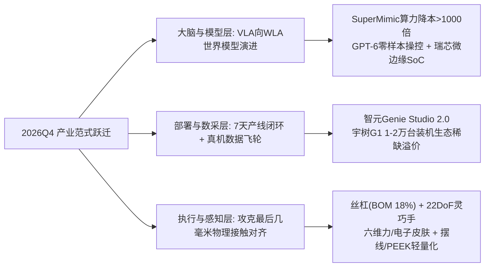

> [!abstract] 买方投委会核心摘要（Executive Summary）
> - **数据基准**：2026-11-05 14:05（星期四，UTC+8）；A股2026年三季报（26Q3）全样本核验完毕。
> - **关联前序宏观与个股笔记**：[[2026-11-01 A股政策底与市场底复盘及下周波段交易计划(IM2703)]] | [[2026-11-02 近期A股密集救市与稳市场政策时间线复盘及深度评述]] | [[2026-11-03 A股与IM2703周二波段交易作战方案及多情景预案]] | [[蓝思科技(300433) 深度跟踪：中报落地与最新进展 2026-08-31]]
> - **宏观与板块择时定调**：10月29—30日海外鹰派预期+美股费城半导体暴跌+三季报业绩雷引发的急跌，已将10月23日机器人板块高达 **27.0%** 全市场成交占比（人形分支14.85%）的短线过热浮筹清洗干净。随着11月2—5日“中央汇金类平准基金稳市机制”定调、两市放量重回2万亿，中证机器人指数PE(TTM)处于近一年 **1.65%极低分位（~46.5x）**，华夏机器人ETF（`562500`）在大跌中逆势净申购至 **187.53亿份**。==当前板块正处于“拥挤度回落至8%-10%健康区 + 宏观稳市托底 + 11月下旬至明年Q1产业催化密集兑现”的黄金右侧波段（Swing Long）窗口。==
> - **产业核心范式切换**：竞争焦点已从“本体硬件炫技”全面转向 **“物理AI（Physical AI）世界模型 + 真机部署数据飞轮 + 最后几毫米接触对齐”**。整机端价格战先于规模化（小双足破万元、宇树R1压至2.99万、26Q3本体厂增收不增利），**超额收益高度收敛于“卡住BOM成本咽喉 + 26Q3主业高增提供现金流护城河 + 具备泰国/北美海外产能”的核心卖铲人**。
> - **首选波段组合（Top Swing Picks）**：
>   1. **右侧戴维斯双击主力（45%权重）**：**震裕科技（`300953`）**（29x动态PE+丝杠/储能双驱新高）、**鸣志电器（`603728`）**（26Q3扣非暴增+204%，紧贴5/10日线蓄势待突破，预期差最大）、**柯力传感（`603662`）**（六维力刚需+Q3净利拐点+25.9%）、**浙江荣泰（`603119`）**（营收+52%+狄兹微型丝杠泰国年底放量）。
>   2. **低估值机构防守中军（35%权重）**：**双环传动（`002472`）**（9月终止环动分拆资产留存母公司+29x PE+公募Q3加仓第一）、**科达利（`002850`）**（24x PE现金牛+Q3净利+40.5%+控股科盟切入T链/Figure轻量化减速器）、**恒立液压（`601100`）** / **汇川技术（`300124`）**。
>   3. **高Beta动量卫星与情绪锚（≤20%权重）**：**瑞芯微（`603893`）**（端侧小脑算力王，Q3扣非+92%涨停突破，等回踩承接）、**北特科技（`603009`）** / **奥比中光-W（`688322`）**，并以 **宇树科技-W（`688836`）** 作为全板块情绪温度计。

---

## 一、 产业全景与核心热点方向捕捉：为什么“物理AI”引爆新一轮重估？

### 1.1 商业化跨越分水岭：从“买回去研究/表演”走向“进厂干活与进家庭陪伴”
2026年人形机器人正式告别实验室展台，跑出硬核出货数据：
- **全球交付与国内统治力**：据 [IDC 2026年9月跟踪报告](https://www.idc.com/resource-center/blog/%E5%8D%8A%E5%B9%B4%E5%87%BA%E8%B4%A7-2-5-%E4%B8%87%E5%8F%B0%EF%BC%8C%E5%90%8C%E6%AF%94%E5%A2%9E%E9%95%BF432-1%EF%BC%9A%E5%85%A8%E7%90%83%E4%BA%BA%E5%BD%A2%E6%9C%BA%E5%99%A8%E4%BA%BA%E5%95%86%E4%B8%9A/)，**2026H1全球人形机器人出货近2.5万台（同比+432.1%）**，其中中国市场出货超1.9万台（占全球77.9%），**中国厂商出货量占全球95%以上**；工信部口径2026全年中国广义产量有望突破10万台；同时传统工业机器人强劲复苏，1—9月全国产量达79.48万套（同比+29.1%）。
- **买家结构质变**：科研教育、商演展示（日租金已从去年3万元暴跌90%至3000元）、政府数采中心三大非工业轻场景合计占比从2025全年的 **83.8% 降至 2026H1 的 69.0%**，腾出的近15个百分点真实流向了**汽车总装/BMS产线、3C上下料、仓储物流与C端家庭陪伴**（如上纬新材旗下启元机器人Q1/T1定价1.99万起，发售1个月于10月25日实现第5000台量产下线；松延动力Bumi更是把双足人形拉进9,998元）。

### 1.2 四大核心热点方向：技术范式切换指明的Alpha主线

1. **热点一：物理AI（Physical AI）突破窗口前移，装机生态与端侧算力重估**
   - **催化剂**：10月22日杭州世界物理AI大会上，宇树王兴兴改口确认物理AI突破窗口大幅前移至 **“1—3年（最快2027年迎来具身ChatGPT时刻）”**，现场展示 GPT-6 Astra 零代码纯Prompt驱动宇树G1完成洗笔绘画与对弈；同期 CoRL 2026 Oral 论文 *SuperMimic* 利用单一可微世界模型将全身控制训练算力开销降低 **>1,000倍**（单张H100训3小时超越2.1万GPU小时的SONIC）；智元发布 **Genie Studio 2.0** 将工业新场景部署压缩至最快7天。
   - **投资映射**：底层大模型泛化瓶颈松动后，拥有最大真机装机量的本体生态（**宇树科技-W `688836`**、智元控股平台 **上纬新材 `688585`**）及机器人“小脑+边缘AI”算力统治者（**瑞芯微 `603893`**）迎来估值锚切换。

2. **热点二：“最后几毫米物理接触对齐”——22自由度灵巧手、六维力与电子皮肤**
   - 王兴兴明确指出当前物理AI唯一核心卡点是**多模态大模型与物理本体在接触瞬间的对齐误差**。与此同时，特斯拉弗里蒙特工厂已启动 **Optimus Gen3** 早期量产（马斯克预告**11月下旬发布最新实机视频**），灵巧手升级至22个主动自由度并导入全手阵列式触觉感知，叠加宇树发布 Dex5-S、智元发布 OmniHand 3 Ultra。
   - **投资映射**：微特电机龙头（**鸣志电器 `603728`**）、六维力传感器（**柯力传感 `603662`**，国产化率<30%）、具身3D视觉（**奥比中光-W `688322`**）。

3. **热点三：BOM第一痛点“丝杠（反向行星滚柱+0301微型丝杠）”与海外产能落地**
   - 丝杠占整机BOM成本约 **18%**（高于减速器的15%）。2026下半年产业分水岭在于：**从实验室送样全面转入昆山/泰国/墨西哥万套级产线投产对账**，且为规避关税壁垒，具备泰国/北美本地化工厂的供应商获得T链一供倾斜。
   - **投资映射**：**震裕科技 `300953`**、**浙江荣泰 `603119`**（控股狄兹精密+泰国基地年底周产1000-2000套）、**北特科技 `603009`**（昆山+泰国CapEx暴增257%）、**恒立液压 `601100`**。

4. **热点四：关节减重与抗冲击新路线——轻量化摆线针轮、PEEK齿轮与轴向磁通电机**
   - 针对谐波柔轮在下肢高频冲击下易疲劳、传统RV过重的痛点，2026年下肢髋/膝/腰重载关节加速导入**轻量化摆线针轮减速器**与**PEEK复合材料齿轮**，电机端向高扭矩密度**轴向磁通电机（SMC软磁）**演进。
   - **投资映射**：**双环传动 `002472`**（RV第一+摆线+PEEK齿轮）、**科达利 `002850`**（控股科盟创新建泰国谐波+PEEK减速器基地）。

---

## 二、 2026年三季报（26Q3）基本面深度拆解与买方“排雷清单”

10月底收官的26Q3财报令板块逻辑彻底从“讲故事”进入“验成色”阶段。全市场122家机器人概念公司26Q3单季归母净利整体同比 **-2.96%**，内部分化极其惨烈：

### 2.1 本体与白马层的“真实表情”还原
- **宇树科技-W（`688836.SH`）**：2026年8月19日科创板上市（发行价150.8元），首份三季报显示前三季营收 **18.17亿元（+55.7%）**、归母 **3.87亿元（+270.5%）**；但 **26Q3单季营收6.65亿元（+69.9%），归母净利1.13亿元（同比-17.4%、环比-49%）**——“增收不增利”主因Q3研发费用暴增 **+249.6%**（达1.27亿，费率19.1%）重金砸向物理AI自进化大模型。摩根大通于10月25日将其评级从“低配”连升两级至“增持”，目标价从300元暴力上调至 **995元**（按2028E 133.8亿营收给30x PS），交易的是A股唯一盈利本体龙头的**生态稀缺性溢价**。
- **汽零/果链大白马的“汇兑假摔”**：**三花智控（`002050`）**（Q3归母-9.6%）、**拓普集团（`601689`）**（Q3归母-4.8%，但**环比大增+35.9%**）、**恒立液压（`601100`）** 及 **蓝思科技（`300433`）**（详见前序笔记 [[蓝思科技(300433) 深度跟踪：中报落地与最新进展 2026-08-31]]，前三季归母-50.1%）表观同比下滑的核心拖累均为**人民币升值导致数亿元汇兑损失**（如三花汇兑损失3.83亿+赛力斯港股基石浮亏2.12亿；恒立汇兑及掉期减少利润5.36亿）。剔除汇兑后，**恒立Q3单季扣非实际大增+39.1%，三花Q3毛利率逆势提升至28.89%（+0.87pct），领益智造（`002600`）受益苹果折叠机 iPhone Duo Q3归母环比暴增+210%**。

### 2.2 买方严选：五大 26Q3 财报“避坑黑名单”（坚决规避追高）

> [!danger] 买方风控红线：警惕“假暴增”与“百倍PE+主业崩塌”标的
> 1. **五洲新春（`603667`）【非经常性损益“假暴增”陷阱】**：26Q3单季表观归母净利暴增 **+3875.18%（9.22亿元）**，实则全靠所持洛阳轴承集团股权公允价值重估确认收益 **10.69亿元**！实际 **Q3单季扣非净利仅 0.15亿元（同比-34.88%）**，受空调管路大客户需求萎缩严重拖累。
> 2. **双林股份（`300100`）/ 安培龙（`301413`）/ 芯动联科（`688582`）/ 福莱新材（`605488`）【高估值业绩暴雷】**：
>    - 双林股份：Q3单季归母净利 **-78.01%**（仅2529万），丝杠尚无法对冲主业失速与高研发；
>    - 安培龙：前三季归母净利暴跌 **-86.58%** 至仅981万元，净利率跌至1.01%；
>    - 芯动联科：Q3单季营收 **-66.03%**，单季净利 **-102.14%罕见转亏**；
>    - 福莱新材：电子皮肤炒作火热，但Q3单季归母净利仅 **411.6万元（同比-69.9%、环比-87%）**。
> 3. **长盈精密（`300115`）【增收转亏】**：前三季具身智能零组件收入虽增532%，但体量尚小，Q3单季净亏损 **-0.84亿元**（前三季累计转亏-0.66亿）。
> 4. **兆威机电（`003021`）【估值与基本面严重劈叉】**：灵巧手整手卡位虽好，但26Q3营收转负（-4.94%）、净利连续三期下滑（-29.4%），机器人收入占比仅约 **1.4%**，动态PE高达 **160x**，仅可作短线游资情绪观察，不宜作为基本面重仓股。
> 5. **地平线机器人-W（`09660.HK`）【可转债浮盈假扭亏 + 12月转股抛压】**：26H1账面净利35—40亿系CARIAD可转债公允价值变动，核心经营仍亏损，且 **2026年12月7日** 面临可转债（转股价3.99港元）到期强制转股的筹码冲击窗口。

---

## 三、 近期盘面微观结构与 2026Q3 机构筹码博弈拆解

### 3.1 资金面与拥挤度：洗盘充分，ETF底部锁仓
结合 [[2026-11-01 A股政策底与市场底复盘及下周波段交易计划(IM2703)]] 中的宏观框架，本周（11/02—11/05）市场完美演绎了“消化美股芯片暴跌低开洗盘 $\rightarrow$ 稳市政策共振放量反攻”的剧本：
- **拥挤度健康回落**：10月23日机器人板块占A股总成交额27.0%的极值已在10月29—30日双创近9%的急跌中充分换手，随着11月4日两市放量至2.04万亿（半导体、光伏、机器人多线开花），当前人形机器人核心分支成交占比回落至 **8%—10%的健康活跃带**。
- **聪明钱逆势锁筹**：全市场最大 **华夏机器人ETF（`562500.SH`，规模165.4亿）** 在10月底暴跌三日内逆势净流入1.51亿元，截至11月4日份额达 **187.53亿份**，10月以来相对创业板指跑出 **+17.6个百分点** 的强Alpha。

### 3.2 2026Q3 三路机构底牌曝光（预期差来源）
1. **外资主权基金（QFII/ADIA + 北向）**：只买“高现金流+低估值制造霸主”，减持高波与毛利承压股——**阿布达比投资局（ADIA）Q3对恒立液压暴买+58.3%**，北向加仓恒立液压 **+6.88亿**、加仓柯力传感 **+23.5%**；同时北向减持绿的谐波（-22.5%，担忧毛利率同比降6.2pct至33.4%）、拓普集团（-22.3%）。
2. **内资社保与GARP名将**：重仓“进可攻退可守”的真成长部件——**双环传动** 获公募单季加仓第一（+2.12亿）+社保418增持；**北特科技** 获社保104暴买 **+150%**、**谢治宇（兴全合润）** 与中欧时代先锋新进锁仓；**谢治宇** 同时在底部大举逆势抄底 **蓝思科技**。
3. **高锐度赛道专精基（永赢先进制造 / 鹏华碳中和 / 诺安）**：高浓度聚焦科创板稀缺品种——齐进 **宇树科技-W** 首份三季报前十流通股东，永赢连续两个季度暴买 **奥比中光-W**（持股突破1026万股占流通盘3.21%）。

---

## 四、 宏观对冲基金 Swing Trading 实战推荐标的与点位作战表

> [!important] Swing Trading 核心交易铁律（2026年11月执行准则）
> 1. **买在均线收敛蓄势或突破回踩，绝不在单日大涨 >15% 次日高开追高**：11月4—5日板块连续反弹后，部分领涨股短线距5日均线（MA5）正乖离已超10%—15%，必须严格按下方**“挂单承接区”**分批低吸，或选择**“蓄势待突破”**的低乖离品种（如鸣志电器、双环传动）。
> 2. **催化锚定波段节奏**：本轮波段核心兑现窗口看 **11月下旬（特斯拉Optimus Gen3实机新视频）** 与 **12月中下旬（智元港股招股书/GO-3开源 + 高工年会全年出货对账）**，持仓周期建议 **2—5周**。
> 3. **波动率仓位控制**：基于14日真实波幅（ATR14）设定硬止损，单票最大亏损严格控制在组合净值的 **0.8%—1.2%** 以内。

### 4.1 核心推荐组合总览与精确波段点位表（基准价截至 2026-11-05 14:05）

| 梯队与建议权重 | 代码 / 简称 | 11/5现价 (市值) | 动态PE (26E) | MA5 / MA10 / MA20 | ATR(14) | 波段建仓区间 (Entry) | 硬止损位 (Stop) | 分批止盈目标 (Target 1 / 2) | 预估盈亏比 (R:R) |
| :--- | :--- | :---: | :---: | :---: | :---: | :---: | :---: | :---: | :---: |
| **第一梯队：戴维斯双击主力** *(合计 45%)* | **`300953.SZ`** **震裕科技** ⭐ | **106.39** (261亿) | **29.1x** | 92.48 / 90.44 / 85.76 | 8.62 | **96.5 – 100.5** *(等回踩前高颈线/5日线)* | **90.00** *(破MA10止损)* | **122.0 / 135.0** | **2.8 : 1** |
| **第一梯队** | **`603728.SH`** **鸣志电器** ⭐ | **59.91** (251亿) | 188.0x *(Q3扣非+204%)* | 58.83 / 58.32 / 53.08 | 4.15 | **58.0 – 59.8** 低吸50% 放量站稳 **61.6** 加50% | **54.80** *(破缺口与MA20)* | **68.5 / 76.0** | **3.0 : 1** |
| **第一梯队** | **`603662.SH`** **柯力传感** | **55.23** (155亿) | 49.9x | 51.94 / 51.28 / 47.75 | 3.56 | **52.2 – 53.8** *(回踩箱体突破颈线)* | **49.50** *(破涨停阳线底)* | **63.0 / 70.0** | **2.7 : 1** |
| **第一梯队** | **`603119.SH`** **浙江荣泰** | **62.08** (294亿) | 89.9x | 58.54 / 58.20 / 52.43 | 4.61 | **57.8 – 59.5** *(回踩MA5/MA10承接)* | **54.50** *(破10月底低点)* | **69.0 / 74.0** | **2.6 : 1** |
| **第二梯队：低PE机构中军** *(合计 35%)* | **`002472.SZ`** **双环传动** ⭐ | **44.26** (376亿) | **30.7x** | 42.51 / 42.41 / 39.27 | 2.97 | **42.2 – 43.5** 低吸 或突破 **45.6** 跟进 | **39.80** *(破MA20趋势线)* | **50.0 / 54.0** | **2.5 : 1** |
| **第二梯队** | **`002850.SZ`** **科达利** ⭐ | **176.68** (505亿) | **24.8x** | 163.99 / 160.99 / 153.74 | 11.72 | **164.0 – 169.5** *(回踩MA5上方承接)* | **153.00** *(破MA20止损)* | **198.0 / 212.0** | **2.4 : 1** |
| **第二梯队** | **`601100.SH`** **恒立液压** | **91.07** (1223亿) | 42.6x | 86.72 / 86.86 / 84.63 | 5.16 | **86.5 – 88.5** *(回踩MA5/MA10)* | **83.00** *(破MA20下方)* | **102.0 / 108.0** | **2.6 : 1** |
| **第三梯队：高Beta卫星** *(合计 ≤20%)* | **`603893.SH`** **瑞芯微** | **217.81** (922亿) | 51.9x | 191.20 / 196.97 / 194.13 | 15.80 | **200.0 – 206.0** *(涨停勿追，等回踩平台顶)* | **188.00** *(跌回平台内部)* | **242.0 / 258.0** | **2.5 : 1** |
| **第三梯队** | **`603009.SH`** **北特科技** | **52.12** (181亿) | 131.7x | 49.43 / 49.83 / 46.71 | 3.54 | **49.5 – 50.8** *(回踩均线密集区)* | **46.50** *(破MA20止损)* | **58.5 / 63.0** | **2.6 : 1** |
| **第三梯队** | **`688836.SH`** **宇树科技-W** | **691.00** (2806亿) | 544.3x *(流通盘208亿)* | 655.38 / 657.12 / 558.50 | 77.81 | **645.0 – 660.0** *(≤5%轻仓博弈MA5/10)* | **605.00** *(破箱体中枢)* | **740.0 / 830.0** | **2.3 : 1** |
| **指数工具替代** | **`562500.SH`** **机器人ETF** | **0.884** (165亿) | 指数46.5x *(1.65%分位)* | 0.85 / 0.86 / 0.84 | 0.04 | **0.855 – 0.870** | **0.825** | **0.950 / 0.985** | **2.5 : 1** |

---

### 4.2 重点推荐个股深度逻辑卡片（Thesis & Catalyst）

#### 1. 震裕科技（`300953.SZ`）—— 全板块罕见的“29倍PE + 60%业绩高增 + T链丝杠直接对接”首选标的
- **核心推荐逻辑**：在丝杠赛道普遍100x—150x PE或主业下滑的背景下，震裕科技实现了极其稀缺的 **PEG < 0.5**。26Q1-Q3营收106.09亿（+60.91%）、扣非净利6.52亿（+63.87%），26Q3单季归母环比暴增 **+75.17%**（受益于储能/动力锂电结构件高景气、电机铁芯放量及Q3铝价回落修复毛利率）。机器人端，公司反向式行星滚柱丝杠、线性执行器模组及灵巧手微型丝杠/微齿已**直接对接海外T链大客户**并向国内头部本体厂小批量供货。
- **波段交易策略**：11月4日放量大涨19.65%后今日续涨逾5%创阶段新高（109.53元），上升趋势已完全打开，但短线距MA5（92.48元）正乖离偏大。**耐心等待未来3—5个交易日缩量回踩 96.5—100.5元（前高突破颈线与上移5日线共振区）分两笔建仓**。

#### 2. 鸣志电器（`603728.SH`）—— 26Q3扣非暴增204%却尚未突破前高，当前最具赔率的“蓄势潜伏王”
- **核心推荐逻辑**：本轮“最后几毫米接触对齐”与特斯拉11月下旬Optimus Gen3实机视频最核心的硬件增量在于 **22自由度新一代灵巧手**。鸣志作为全球空心杯与无刷微特电机绝对龙头（携瑞士T Motion技术与海外基地），**26Q3单季扣非净利暴增 +204.29%（达6305万元）**，基本面已率先走出两年低谷；反观同赛道的兆威机电Q3净利下滑29%却在10月大涨近40%，鸣志目前股价（59.91元）仍紧贴MA5（58.83）/MA10（58.32）窄幅横盘，**基本面与股价涨幅存在显著正向剪刀差**。
- **波段交易策略**：当前乖离率极低、盈亏比最佳！**现价 58.0—59.8元 可直接配置50%底仓**，一旦放量突破20日箱体上沿 **61.60元** 顺势打满剩余50%仓位，第一目标直看68.5—70元，中期剑指前高76元。

#### 3. 双环传动（`002472.SZ`）& 科达利（`002850.SZ`）—— 大资金进可攻退可守的“双低估值现金牛”
- **双环传动（29.3x PE）**：**2026年9月主动撤回子公司环动科技科创板分拆IPO申请**，意味着国内市占率第一的RV减速器及正在放量的下肢抗冲击**轻量化摆线针轮减速器、PEEK齿轮**核心资产100%留在母公司股东名下，消除了股权摊薄折价！26Q3公募单季净加仓全板块第一，技术面沿5/10日线稳步推升即将突破45.55元前高，适合稳健资金重点配置。
- **科达利（24.0x PE）**：26Q3单季营收+45.7%、归母净利+40.5%（5.84亿），账面现金超26亿元。通过控股56%的**深圳科盟创新**（联手台湾盟立/盟英）在泰国建设谐波与PEEK轻量化减速器产线，已强势切入T链与Figure链，市场目前仍按传统锂电结构件给24倍估值，机器人期权近乎免费赠送。

#### 4. 柯力传感（`603662.SH`）& 瑞芯微（`603893.SH`）—— 物理AI“触觉刚需”与“端侧算力铲子”
- **柯力传感**：六维力传感器在人形手腕/脚踝单机需4—8颗、国产化率不足30%。公司4月起机器人力学传感器月订单持续破千只，26Q3单季归母净利破亿（+25.9%）、毛利率升至45.8%，获北向与社保同步加仓，11月4日涨停突破平台后今日缩量良性整固，回踩52.2—53.8元买点清晰。
- **瑞芯微**：无论宇树、智元还是二线本体厂谁在价格战中胜出，边缘控制器与视觉处理都绕不开 RK3588 / RK182X 算力芯片（26Q3单季扣非+92.1%）。今日放量涨停突破217.81元创阶段新高，遵循Swing纪律**绝不追涨停次日高开，耐心等回踩200—206元突破平台顶再行介入**。

> [!tip] 港股观察哨：优必选（`09880.HK`）的AH溢价收敛套利机会
> 10月以来A股本体（宇树+52%、上纬+44%）狂飙，而港股 **优必选（`09880.HK`）** 因消费级U1交付下调（从1万台调至1500—2000台）及美债利率压制一路跌至 **60.20港元** 52周新低，AH估值剪刀差拉至极端。但优必选B端全尺寸工业人形 Walker S2 上半年收入暴增1445%（毛利率高达66.8%，获空客百台订单及多家车厂复购），11月5日已在60港元上方放量止跌反弹（现报65.75港元）。若你有港股仓位，可将其列入右侧观察：守稳 **60.0港元** 前提下，博弈Q4 EBITDA转正指引兑现带来的超跌修复（阻力目标 **75—80港元**）。

---

## 五、 2026Q4—2027Q1 关键跟踪节点与风险对冲清单

### 5.1 未来5个月核心事件催化时间轴
- **2026年11月下旬**：**特斯拉发布 Optimus Gen3 最新实机视频**（重点验证22自由度灵巧手精细装配，直接催化鸣志、震裕、荣泰、北特）。
- **2026年11—12月**：**智元创新递交港股IPO招股书（A1）**（披露全年财务与前五大供应商，催化上纬新材、均普智能、蓝思科技）。
- **2026年12月中旬**：**2026高工机器人年会（深圳）**（核心零部件全年真实出货量终盘对账，去伪存真）。
- **2026年12月底**：智元具身基座模型 **GO-3 全面开源** + 小鹏 IRON 冲击月产千台 + 赛力斯多形态机器人发布 + 优必选 26Q4 EBITDA 转正大考。
- **2027年1—2月**：**CES 2027（消费级个人具身机器人首秀）** + **2027央视春晚（物理AI多机自主协同秀）**。
- **2027年4月1日**：我国**首批六项人形机器人国家标准**正式强制实施 + 特斯拉 Optimus 换装 **AI 5芯片**。

### 5.2 核心下行风险与对冲策略
1. **海外宏观与关税冲击**：美联储12月FOMC若超预期加息，或北美针对中国机器人零部件加征关税（因此组合中优先选择了已在**泰国、墨西哥、欧洲**落地海外产能的震裕、荣泰、鸣志、双环、科达利、恒立）。
2. **T链量产排期再度后移风险**：马斯克已将Optimus大规模对外商业化交付指引后移至2027年底，若11月下旬演示视频不及预期，纯高估值T链概念股（PE>120x且无主业支撑）将面临20%+回撤。
3. **组合层面对冲建议**：若持有多头高弹性机器人个股组合，可结合你在 `Trade/` 中的股指期货工具，在板块单日成交额占比再度突破 **15%—20%（人形分支>14%）** 的情绪极值日，分批兑现1/3—1/2浮盈，或用 **IM（中证1000股指期货）** 阶段性锁住系统性Beta回撤风险，纯粹提取优质选股的超额Alpha。

---

## 附录：本地调研底稿索引
本次调研采集的完整一手数据底稿已同步落盘保存于工作区 `outputs/` 目录：
1. `outputs/01_具身智能与物理AI行业全景及催化日历_20261105.md`
2. `outputs/02_产业链六大环节壁垒与2026三季报基本面排雷_20261105.md`
3. `outputs/03_A股机器人板块盘面结构_机构筹码与量价快照_20261105.md`
4. `outputs/2026-11-05_中国机器人与具身智能产业深度调研及波段交易策略报告.md`
