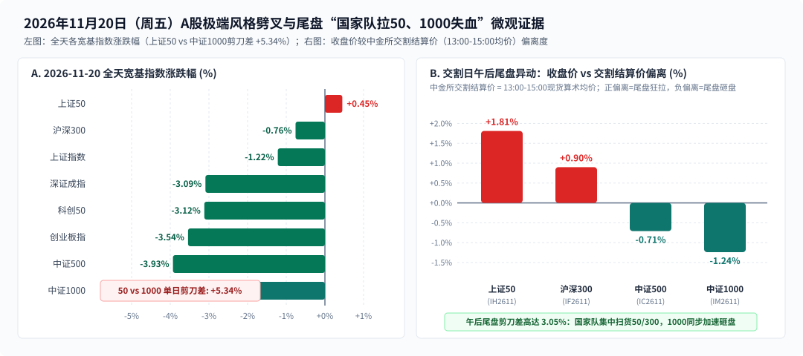
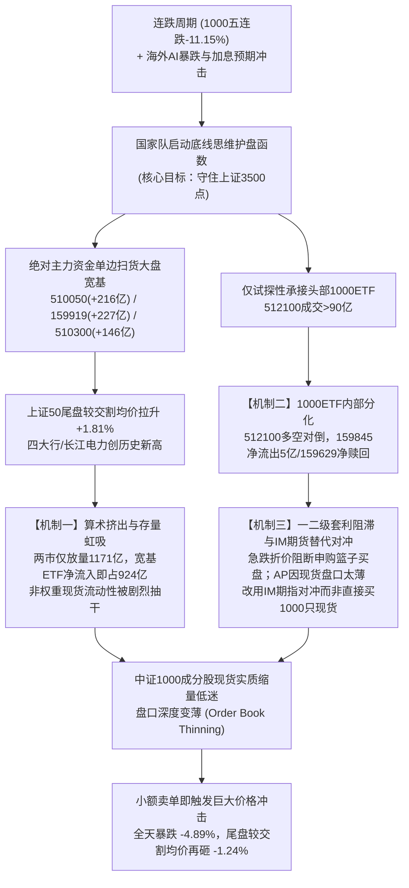
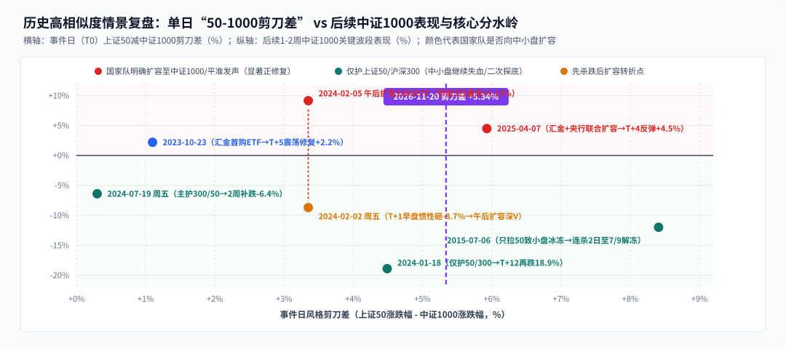
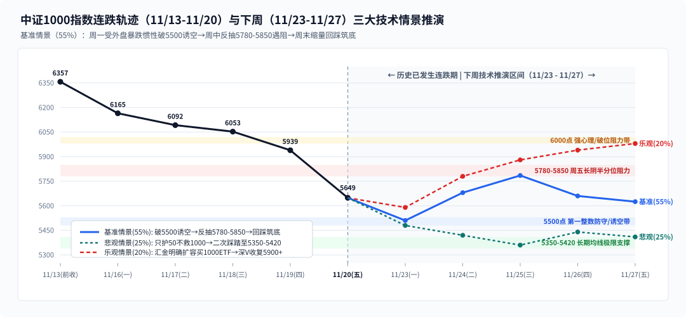

# 2026-11-22 中证1000极端冲击深度调研：ETF放量与现货低迷背离、历史同构对比及下周（11.23–11.27）技术推演

> [!summary] 核心摘要（Executive Summary）
> - **数据截点**：A股截至 **2026-11-20（周五）15:00 收盘**（兼11月股指期货交割日）；美股、A50期指及跨资产截至美东 **2026-11-20（周五）收盘**（北京时间 11-21 凌晨）；国内政策与周末消息面截至 **2026-11-22 16:30**。
> - **关联笔记**：[[2026-11-18 英伟达Q3财报复盘与A股日内V反及后半周波段交易计划]] · [[2026-11-15 周末全球宏观复盘与下周A股波段交易计划]] · [[2026-10-16 300ETF超跌放量与RSI连续钝化历史研究及IM2703测算]] · [[2026-10-16 A股超跌放量信号研究与IM2703交易框架]] · [[2026-11-01 A股政策底与市场底复盘及下周波段交易计划(IM2703)]]
> - **一句话定性**：2026年11月20日（周五）是A股在连跌周期中爆发的典型 **“政策底试探性显现 + 流动性剧烈分层”过渡态（Transition Regime）**——国家队借道大盘宽基ETF暴力做多上证50守住3500点，但全市场增量被权重ETF完全挤出，导致中证1000成分股现货实质缩量低迷并遭遇尾盘踩踏（收跌 **-4.89%**，周五连跌累计 **-11.15%**）。
> - **四大核心量化结论**：
>   1. **“ETF放量 vs 1000现货低迷”的算术铁证**：周五两市总成交 1.42 万亿元，仅较周四（~1.30万亿）温和放量 **1,171亿元**，但单日全市场宽基ETF净流入即达 **923.63亿元**（`510050` 成交243.38亿/净流入215.83亿、`159919` 成交234.80亿/净流入226.51亿、`510300` 净流入145.83亿）。扣除大盘ETF与新高红利银行股后，中证1000成分股现货不仅未放量，反而严重失血缩量、盘口深度枯竭。
>   2. **交割结算价揭露的午后微观镜像**：中金所11月合约交割结算价（13:00–15:00算术均价）与收盘价之差直接锁死尾盘资金轨迹——**上证50收盘高于午后均价 +1.81%（2785.92 vs 2736.50），中证1000收盘反而低于午后均价 -1.24%（5648.63 vs 5719.65）**，午后两小时内大小盘形成 **3.05%** 反向剪刀差，全天剪刀差高达 **+5.34%**。
>   3. **历史同构规律的“唯一分水岭法则”**：系统回溯A股 6 次高度相似情景（`2024-01-18`、`2024-02-02→02-05`、`2024-07-19`、`2025-04-07`、`2023-10-23`、`2015-07-06`）并对照 [[2026-10-16 300ETF超跌放量与RSI连续钝化历史研究及IM2703测算]]，核心结论高度一致：**连跌中单边护盘上证50/300从不自动等于中小盘一步到位见底（T+1中证1000惯性下探概率极高）**；后续一周是重演“二次流动性踩踏”（`2024-01-18`后T+12再跌18.9%、`2024-07-19`后两周补跌6.4%），还是开启“绝地深V”（`2024-02-05`扩容后3日+9.15%），**唯一决定变量是国家队是否从50/300实质性扩容并持续净申购全系列中证1000/500ETF**。
>   4. **下周（11/23–11/27）技术路径与操作定调**：周五A股收盘后，**周五美股夜盘发生更猛烈崩盘**（纳指 **-5.28%**、标普500 **-3.70%**、英伟达 **-14.01%**、费城半导体 **-10.73%**、金龙指数 **-3.40%**、富时A50夜盘 **-1.12%/-1.40%**）；但周末（11/21–22）国内密集释放汇金类“平准基金”、第三批1000亿SFISF、回购再贷款常态化与两融逆周期优化组合拳。基准情景（**55%概率**）下，中证1000大概率走出 **“周一早盘受外盘冲击破5500点惯性诱空 → 午后托底拉长下影 → 周二周三超跌反抽测试5780–5850点遇阻 → 周末缩量回踩5550–5650点二次筑底”**；**策略上切忌周一早盘无承接时左侧盲目接飞刀，更切忌周中无量反抽至5800上方时追高**。

---

## 一、从11月15日到11月20日：行情演化的完整时间线与周五全景复盘

### 1.1 前序节点衔接：为何周三（11/18）的“地量V反”在周四周五演变为流动性崩塌？

衔接前序笔记 [[2026-11-15 周末全球宏观复盘与下周A股波段交易计划]] 与 [[2026-11-18 英伟达Q3财报复盘与A股日内V反及后半周波段交易计划]]，上周A股的演化并非突发黑天鹅，而是**“海外分母端收紧 + 英伟达治理折价全面发酵 + 深圳APEC维稳窗口关闭 + 期指交割日负反馈”**四重力量共振破位的结果：

- **11月16日—17日（周一至周二）**：消化周末美国10月PPI（+6.5%）/CPI（+0.4%）粘性与10Y美债破5.1%的冲击，上证指数跌破3600点，中证1000先跌 -3.03% 再跌 -1.17%，工行创历史新高对冲。
- **11月18日（周三）**：美东11/17盘后英伟达FY27 Q3财报营收1158亿美元（+103% YoY）全面Beat，但电话会新任董事长 Harvey Jones 明确拒绝黄仁勋回归；午间证监会辟谣“公募上报AI敞口”传闻，叠加工信部6G试点与**深圳APEC峰会维稳窗口**，A股在1.37万亿地量下走出日内V反（上证微涨+0.09%，科创50涨+2.19%），但注意——**中证1000当日仍逆势收跌 -0.65%**，小盘失血隐患并未消除。
- **11月19日（周四）**：APEC维稳窗口步入尾声，两市进一步缩量至约 **1.30万亿元** 年内低量区间，反抽无量导致抛压反噬，**中证1000大跌 -1.88% 正式有效跌破 6,000 点整数大关（收 5,938.90 点）**。
- **11月20日（周五，11月期指交割日）**：海外AI产业链抛售潮与日韩股市暴跌（盘中重挫5%–6%）共振袭来，叠加期指交割日空头移仓与银行红利虹吸，**中证1000加速破位暴跌 -4.89%（收 5,648.63 点，几乎全天最低点收盘），完成罕见日线五连跌、单周重挫约 -11.15%**；而上证指数盘中跌破3500点后，触发国家队天量买入上证50/沪深300ETF暴力护盘，硬生生将上证50从盘中-2%+拉至收涨 **+0.45%**。

### 1.2 上周（11/16–11/20）日度连跌序列

| 交易日期 | 星期 | 上证指数开盘 | 上证指数收盘 | 上证单日涨跌 | 中证1000收盘 | 中证1000单日涨跌 | 关键盘面节点 |
| :--- | :---: | :---: | :---: | :---: | :---: | :---: | :--- |
| *2026-11-13* | *前周五* | — | *3,634.18* | — | *~6,357.24* | — | *反推前收基准* |
| 2026-11-16 | 周一 | 3,611.54 | 3,602.57 | -0.87% | 6,164.62 | **-3.03%** | 中证1000率先破位重挫，《衍生品交易监督管理办法》施行 |
| 2026-11-17 | 周二 | 3,585.67 | 3,584.58 | -0.50% | 6,092.40 | **-1.17%** | 上证失守3600点，个股普跌，工行创历史新高 |
| 2026-11-18 | 周三 | 3,596.55 | 3,587.83 | +0.09% | 6,052.82 | **-0.65%** | 1.37万亿地量，科创50/创业板午后V反，但1000仍收绿 |
| 2026-11-19 | 周四 | 3,583.12 | 3,577.62 | -0.28% | 5,938.90 | **-1.88%** | 缩量至约1.30万亿年内低量；**1000跌破6000点** |
| **2026-11-20** | **周五** | **3,527.30** | **3,533.79** | **-1.22%** | **5,648.63** | **-4.89%** | **交割日+破3500触发924亿宽基ETF净流入；超5200股下跌；50翻红而1000暴跌** |
| **周度合计** | — | — | — | **-2.77%** | — | **约 -11.15%** | **典型“阴跌蓄势 → 破位失血加速”结构** |

### 1.3 11月20日（周五）跨指数极端分化与中金所交割价微观拆解

| 宽基指数 | 11/20收盘点位 | 全天涨跌幅 | 11月合约交割结算价 *(13:00–15:00算术均价)* | 收盘价较交割价偏离 *(午后尾盘冲击度)* | 盘面行为定性 |
| :--- | :---: | :---: | :---: | :---: | :--- |
| **上证50 (`000016`)** | 2,785.92 | **+0.45%** | 2,736.50 (`IH2611`) | **+1.81% (+49.42点)** | 盘中一度跌超2%，午后尾盘国家队暴力拉升银行/长江电力强势翻红 |
| **沪深300 (`000300`)** | 3,954.57 | **-0.76%** | 3,919.42 (`IF2611`) | **+0.90% (+35.15点)** | 大盘权重主托底阵地，午后承接力度极强 |
| 上证指数 (`000001`) | 3,533.79 | -1.22% | — | — | 盘中失守3500点后尾盘被强行托回3500关口上方 |
| 深证成指 (`399001`) | — | -3.09% | — | — | 成长与中小盘权重占优，整体承压 |
| 科创50 (`000688`) | 1,231.09 | -3.12% | — | — | 半导体、先进封装及AI芯片受海外暴跌压制 |
| 创业板指 (`399006`) | 2,212.13 | -3.54% | — | — | 前期强势AI算力硬件/光模块集中杀跌 |
| **中证500 (`000905`)** | 6,006.08 | **-3.93%** | 6,048.73 (`IC2611`) | **-0.71% (-42.65点)** | 午后同步走弱，尾盘缺乏同等力度买盘承接 |
| **中证1000 (`000852`)** | **5,648.63** | **-4.89%** | **5,719.65 (`IM2611`)** | **-1.24% (-71.02点)** | **流动性失血重灾区，尾盘与上证50反向加速砸盘** |

> [!important] 量化取证亮点：中金所交割结算价的“时间戳”价值
> 按照中金所规则，股指期货交割结算价等于交割日最后两小时（13:00–15:00）标的指数的算术平均价。周五11月20日的数据显示：
> - **IH2611 偏离 +1.81% / IF2611 偏离 +0.90%** → 证明国家队买盘在**下午特别是临近收盘的14:00–15:00**集中爆发，以极高斜率暴力拉升大盘权重；
> - **IC2611 偏离 -0.71% / IM2611 偏离 -1.24%** → 证明在同一时间窗口内，中小盘非但没有获得传导提振，反而因为权重虹吸与尾盘止损盘叠加，发生**加速下砸**（收盘点位比下午两小时均价还低整整 71.02 点）。

### 1.4 周五宽基ETF天量成交与净申赎明细（对比 2026-10-16 历史信号）

据同花顺iFinD及盘后清算口径，**2026年11月20日全市场宽基ETF单日合计净流入高达 923.63 亿元**，资金倾斜度极高：

| ETF简称及代码 | 跟踪指数 | 11月20日成交额 | 11月20日估算净流入 | 净流入 / 成交额比 | 资金行为与流向拆解 |
| :--- | :---: | :---: | :---: | :---: | :--- |
| **华夏上证50ETF (`510050`)** | 上证50 | **243.38 亿元** *(较前日暴增8倍+，2015年7月来新高)* | **+215.83 亿元** | **88.7%** | 绝对单边扫货，国家队做多上证50的头号通道 |
| **嘉实沪深300ETF (`159919`)** | 沪深300 | **234.80 亿元** *(上市以来历史最高纪录)* | **+226.51 亿元** *(份额+53.81亿份)* | **96.5%** | 近乎100%单向申购，国家队核心护盘通道 |
| **华泰柏瑞沪深300ETF (`510300`)** | 沪深300 | **>100 亿元** | **+145.83 亿元** | — | 同步巨额净流入（对比 [[2026-10-16 300ETF超跌放量与RSI连续钝化历史研究及IM2703测算]] 中10/16单日160.9亿，本次全市场宽基总合力远超10/16） |
| **南方中证1000ETF (`512100`)** | 中证1000 | **>90 亿元** *(盘中脉冲放量)* | **正向净流入** *(前日11/19净流入超53亿)* | — | 存在左侧大资金/部分国家队试探承接，但盘中多空激烈对倒，未能扭转指数跌幅 |
| **华夏中证1000ETF (`159845`)** | 中证1000 | 14.06 亿元 *(跌4.57%)* | **-5.04 亿元** *(份额-8,700万份)* | **-35.8%** | **关键背离信号：非头部1000ETF反现显著资金净流出** |
| **富国中证1000ETF (`159629`)** | 中证1000 | 温和波动 | **延续净赎回** | 负值 | 中小规模1000ETF持续遭遇机构/短线资金赎回 |

---

## 二、内外部冲击因素深度消息调研

### 2.1 外部冲击：全球AI信仰重定价 + 美联储加息阴影 + 周五美股夜盘二次崩盘

1. **英伟达治理危机升级与全球AI算力链崩塌**：
   - 虽然11/17盘后英伟达Q3营收同比暴增103%至1158亿美元、Vera Rubin平台量产放量，但**11/18董事会明确拒绝黄仁勋复任CEO**彻底剥离了创始人光环溢价；随后市场流传**SEC对英伟达展开会计与信息披露调查的传闻**，叠加**对华H200芯片出口断供预期**，以及Anthropic纳斯达克IPO被华尔街作为AI CapEx泡沫的“利好兑现”窗口、AMD遭做空机构狙击，触发全球科技股多杀多踩踏。
   - 该恐慌在周五白盘直接拖累日韩股市盘中暴跌 5%–6%，并精准击穿A股拥挤度最高的算力硬件、光模块、半导体与中小科技股。
2. **美联储鹰派转风与“重启加息”定价**：
   - 承接10月美国CPI（环比+0.4%）和PPI（同比+6.5%）粘性超预期，美联储会议纪要及多位官员（芝加哥联储、费城联储主席等）集中释放鹰派信号；**摩根大通、法国巴黎银行**等顶级投行上调紧缩预测，警示美联储可能自12月起重启加息甚至连续加息25–50bp。
   - 10Y美债收益率稳居 5.1% 上方、美元维持强势，引发跨资产无差别去杠杆（De-risking）：不仅科技股重挫，黄金下挫、**比特币跌破 $60,000 大关**（较11/15时的 $67,000 再跌超10%），人民币汇率亦面临阶段性外部承压。

> [!warning] 周五夜盘“时差二次冲击”警报（周一早盘核心风险源）
> A股周五15:00收盘时，**尚未计价北京时间11月20日晚至21日凌晨美股的史诗级“黑色星期五”**：
> - **纳斯达克综合指数**：暴跌 **-5.28%**（收 22,617.73 点，抹去全年涨幅；**纳指100较历史高点回撤超20%，跌入技术性熊市**）；
> - **标普500指数**：重挫 **-3.70%**（收 6,910.39 点，七连跌正式跌入技术性回调区间）；道指跌 **-1.93%**（48,147.33）；
> - **英伟达（NVDA）**：单日狂泻 **-14.01%**（收 **$125.53**，连跌七周创2008年来最长周连跌，较10月初近6万亿高点蒸发超2.6万亿美元）；**费城半导体指数（SOX）暴跌 -10.73%**；
> - **VIX恐慌指数**：飙升 **+26.2%** 至 **35.89**（盘中突破40）；
> - **中概与A股期货映射**：**纳斯达克金龙中国指数（HXC）收跌 -3.40%**（小鹏-14%、理想-7.7%、阿里-2.5%，全周累跌约9%）；**富时中国A50期指夜盘收跌 -1.12%**（日内收跌约 **-1.40%**，报 12,517 点）。
>
> **交易含义**：周一（11/23）早盘，A股科技成长链条与中证1000几乎确定将面临 **-1.5% 至 -2.5%** 的外盘跳空低开补跌测试。

### 2.2 内部因素：交割日负反馈、存量虹吸与周末政策托底组合拳

1. **股指期货交割日效应（11月20日为11月合约到期日）**：量化中性与指数增强对冲盘在向 `IM2612 / IM2703` 远月移仓期间，避险情绪高涨导致空头扎堆开仓，IM远月基差贴水幅度走扩，加剧了衍生品对现货的负向情绪传导。
2. **存量市场的极端“红利/权重虹吸效应”**：工商银行、建设银行、长江电力等高股息大权重逆势创历史新高，在1.4万亿存量池中单向抽取流动性，制造出“指数险守3500、个股超5200家下跌”的极端撕裂感。
3. **两融持续退潮与量化/微盘负反馈**：A股**融资余额连续多日回落并创阶段新低**；同时10–11月成交额从前期天量萎缩后，股票量化多头超额收益（Alpha）获取难度上升，部分微盘/小盘暴露策略触发波动率风控或遭遇赎回，形成“下跌 → 缩量 → 冲击成本放大 → 更大跌幅”的自强化负反馈。
4. **公募年末考核与三季报后业绩真空期**：11月下旬机构保年度排名动力极强，普遍主动削减高估值、高波动中小科技仓位，切向低波红利资产与核心宽基防御。
5. **周末（11月21日—22日）国内密集稳市政策缓冲（多头核心底牌）**：
   - **类平准基金明牌定调**：国务院金融工作报告与央行会议明确提出**支持中央汇金公司发挥类“平准基金”作用**，拓宽中长期资金来源与入市方式；
   - **央行流动性与低息弹药加码**：第三批 **1,000 亿元互换便利（SFISF）**落地（中标费率降至 **10bp**）；**股票回购增持再贷款转为长期制度性安排**（利率下调至 **1%**）；短端政策利率正式换锚至 **1.25%** 隔夜逆回购；
   - **证监会逆周期制度优化**：推出护盘式回购四项优化措施（新增“破发”情形、超募资金专项回购注销等）、引导首批主动ETF加快建仓，并对**两融保证金比例等风控指标实施逆周期优化**，直接针对性缓解两融平仓与去杠杆压力。

---

## 三、核心微观结构深度剖析：为何出现“ETF放量 + 1000成分股低迷 + 国家队做多上证50”？

这一盘面组合绝非偶然噪音，而是A股在**连跌周期 + 存量博弈 + 国家队借道ETF干预**框架下的典型微观结构失衡，可拆解为五层严密机制：

### 1. 算术挤出效应：大盘ETF的“渠道隔离式放量”掩盖了中小盘现货的极度缩量
- 11月20日沪深两市总成交 1.42 万亿元，较前一日（~1.30万亿元）增量仅 **1,171 亿元**；
- 同期仅全市场宽基ETF单日净流入就达 **923.63 亿元**，头部四大宽基ETF（`510050`、`159919`、`510300`、`512100`）单日成交较平日激增超千亿元，叠加银行/电力等权重放量新高；
- **结论**：增量成交几乎 100% 沉淀在大盘宽基ETF与红利权重池中，并未外溢至中小盘个股池。**中证1000的1000只成分股在剔除ETF噪音后，呈现的是“无买盘承接的缩量失血阴跌/急砸”**。

### 2. 中证1000 ETF放量却无法托举成分股的三大套利摩擦
1. **内部筹码对倒而非单边净申购**：`510050` 净流入/成交比高达 **88.7%**、`159919` 高达 **96.5%**，属于纯单边增量买盘；而中证1000ETF阵营内部剧烈分裂——`512100` 虽成交破90亿但夹杂大量恐慌盘与量化止损换手，同时 `159845` 净流出 5.04 亿元、`159629` 净赎回，整体净申购合力远不足以扭转1000只成分股的抛压。
2. **二级市场折价（Discount）阻断正向申购传导**：只有在买盘强劲将ETF二级价格推至持续**溢价（Premium）**时，授权参与商（AP/做市商）才会“现货买入1000只成分股篮子 → 一级申购ETF → 二级卖出”从而向成分股注入买盘。周五单边急跌中，1000ETF盘中极易出现平价或折价，正向传导链条断裂；若触发折价套利（二级买ETF → 赎回篮子 → 现货砸盘），甚至会反向放大现货跌幅。
3. **做市商冲击成本规避（IM期指替代现货对冲）**：中证1000成分股多为中小市值、盘口深度薄（Order Book Thinning），当成分股成交低迷时，做市商为规避高昂的现货冲击滑点，盘中常先以流动性高度集中的 **IM股指期货** 对冲ETF库存敞口，而非立刻在现货市场扫货1000只股票，进一步造成“ETF二级成交放量，成分股现货却死水微澜、加速阴跌”的背离。

### 3. 国家队“先大后小、四两拨千斤”的边际效用函数与负外部性
- 国家队护盘的核心目标函数是**用最小资金成本锁住大盘系统性风险底线（本次为上证3500点）**。投入215亿买上证50ETF即可拉红整个上证50并稳住沪指，边际杠杆率极高；
- 但在1.4万亿存量市场下，这种“先大后小”的理性策略会产生显著**负外部性**：场内公募与量化模型识别到“资金只保50/红利、不保1000”，会加速卖出失血的小盘成长股向大盘红利抱团，将单日剪刀差撕裂至 **+5.34%**。

### 4. 连跌周期中段出现该信号的阶段定性（对比 2026-10-16）
- 对比一个月前的 [[2026-10-16 300ETF超跌放量与RSI连续钝化历史研究及IM2703测算]]（10月16日 `510300` 成交160.9亿、量比3.85x、RSI6=7.9，同样发生在持续阴跌之后），本次11月20日宽基ETF放量规模更大（`510050` 243亿 + `159919` 235亿 + 全宽基净流入924亿），说明国家队护盘决心更强；
- **但关键警示在于**：当该信号发生在连续下跌（1000五连跌-11.15%）过程中、且国家队火力尚未全面铺开至中证1000/500时，它标志的是 **“大盘指数政策底确立，但中小盘市场底尚未出清完毕”** 的危险过渡态。

---

## 四、历史高相似度情景回溯与多维对比矩阵

我们系统梳理了2015–2026年A股历史上与2026年11月20日高度同构的 **6 次典型案例**（另附 `2026-10-16` 近期300ETF放量样本作为近距离参照），重点比对事件日剪刀差、国家队是否向中证1000扩容以及后续 **T+1、T+5（下一周）、T+10~20** 的真实演变轨迹。

### 4.1 历史同构案例全维度对比表格

| 案例与日期 | 相似度 | 前期连跌与市场背景 | 当日 50 vs 1000 *(剪刀差)* | 宽基ETF放量与流向结构 | 1000/小盘现货成交特征 | 国家队是否实质扩容至1000 | **T+1 走势** *(次日)* | **T+5 走势** *(后续一周)* | **T+10~T+20 演化与最终底部定性** |
| :--- | :---: | :--- | :---: | :--- | :--- | :---: | :--- | :--- | :--- |
| **本次基准** **2026-11-20（周五）** | 基准 | 11月初高点回落；中证1000**五连跌(-11.15%)**；交割日；超5200股跌 | **+0.45% vs -4.89%** *(+5.34%)* | 宽基净流入**923.6亿**（50ETF 243亿/嘉实300 235亿/1000ETF 90亿+；但159845净流出5亿） | 扣除大盘ETF后1000现货实质缩量低迷；尾盘IM较交割均价再跌-1.24% | **待验证** *(目前极度偏重50/300)* | 待验证 *(周一面临美股纳指-5.28%/A50-1.12%低开冲击)* | 见第五章情景推演 | **核心分水岭**：下周汇金是否全面转向持续净申购全系列1000/500ETF |
| **案例1（最核心警示）** **2024-01-18（周四）** | ★★★★★ | 开年连跌破2800（沪指探2760）；雪球临近密集敲入 | **+1.78% vs -2.71%** *(+4.49%)* | 国家队首度天量扫货大盘ETF：50ETF **108亿(+276%)**、华泰300ETF **152.6亿(+256%)** | 小微盘现货失血，流动性被50/300严重虹吸 | **否** *(仅护50/300)* | 1/19 中证1000**续跌 -2.61%** 至5,014点 | T+5(1/25)借1/24降准短反抽至5,143(**-0.1%**)；上证50相对强势(**+1.5%**) | **反抽后二次崩塌**：因仅护大盘未救小盘，至2/5(T+12)雪球与量化踩踏，1000暴跌至4,177(**再跌 -18.9%**) |
| **案例2（最经典转折）** **2024-02-02（周五）→ 02-05** | ★★★★★ | 连跌中段加速，超4900股下跌，小微盘流动性危机全面爆发 | 周五：**-0.35% vs -3.70%** *(+3.35%)* | 周五宽基ETF持续百亿吸金（总规模破9000亿）；**周一午后1000ETF飙升至87亿** | 周五两市缩量至7,030亿，中小盘买盘枯竭；周一早盘千股跌停 | **初期否 → 周一午后/周二正式官宣扩容** | **周一(2/5)惯性惨杀**：中证1000暴跌 **-6.16%~-8.68%** 探4,177；上证50逆势 **+1.18%** | **周二(2/6)汇金官宣扩容后暴力深V**：2/6中证1000暴涨 **+6.97%**，节前3日累涨 **+9.15%** | **确立史诗级市场大底**：春节后中小盘成为春季行情反弹急先锋 |
| **案例3（同为周五）** **2024-07-19（周五）** | ★★★★☆ | 连续震荡阴跌，三中全会闭幕前后，沪指险守3000点 | **+0.50% vs +0.20%** *(50实现9连阳)* | 9大宽基ETF成交 **463.3亿**（4只300ETF 290亿 + 50ETF 75.8亿） | 权重红利单边虹吸，个股与中小盘交投极度低迷 | **否** *(主攻300/50)* | 下周一(7/22) 央行降LPR，指数高开低走承压 | **次周补跌探底**：上证周跌 **-3.07%**，50跌 **-2.45%**，1000从~5,270回落至~5,115(**约 -3.0%**) | **护盘暂停后继续二次探底**：至8/2中证1000下探4,930一线(**两周再跌 -6.4%**)，直至9月下旬政策全面转向 |
| **案例4（外部极端冲击）** **2025-04-07（周一）→ 04-08** | ★★★★☆ | 美国“对等关税”落地触发全球暴跌与A股破位重挫 | **-5.46% vs -11.39%** *(+5.93%)* | 核心宽基单日净流入超 **480亿**（510300量比5.18x、净流入超175亿）；**汇金盘中官宣+央行再贷款** | 外部恐慌引发流动性休克，跌停潮集中宣泄 | **是** *(汇金+诚通+国新全覆盖)* | 周二(4/8) 50大涨 **+2%+**，1000跌幅大幅收窄企稳 | **当周连续修复**：至4/11沪指连阳收复至3,238(**较4/7反弹+4.6%**)，1000同步修复约 **+4%~+5%** | **快速构筑事件底**：外部利空一次性剧烈出清 + 平准基金与央行同步托底，T+120涨幅显著 |
| **案例5（温和磨底）** **2023-10-23（周一）** | ★★★☆☆ | 连续阴跌破3000点（收2,939），超4500股下跌 | **-1.10% vs -2.20%** *(+1.10%)* | **中央汇金首次正式公告买入ETF**并承诺继续增持，50/300ETF尾盘放量 | 中小盘缩量普跌，市场情绪降至冰点 | **否** *(大盘宽基为主)* | 次日(10/24) 情绪修复，大盘与中小盘集体温和反弹 | **震荡修复约 +1.8%~+2.2%**：权重抗跌，中小盘先抑后扬 | **先反弹后漫长磨底**：1–2周围绕2900–3000反复拉锯，但因缺乏小盘增量，至2024年1月才最终出清 |
| **案例6（早期极端对照）** **2015-07-06 → 07-08** | ★★★☆☆ | 杠杆牛崩塌连续暴跌，配资平仓引发千股跌停 | **沪指+2.41% vs 小盘大面积跌停** *(剪刀差 >8%)* | 21家券商集结1,200亿买蓝筹ETF，国家队只拉50/两桶油 | **流动性彻底冰冻**：超1,340股停牌+近900股跌停，现货成交窒息 | **否** *(至7/9全面解冻)* | 7/7–7/8 **连续两日惨烈续杀**（7/8沪指 **-5.90%** 险守3,500） | 至7/8晚大股东禁减持+IC空头保证金提至20%+查做空，**7/9绝地V反(+5.76%)** | **“只救权重不救小盘”必致失血蔓延**；唯有打通中小盘流动性、封杀恶意做空才能真反转 |
| *近月参照* *2026-10-16（周五）* | *近距参照* | *持续4个月阴跌（300自高点回撤17.6%）；RSI6=7.9* | *大盘300放量护盘* | *510300 单日成交 **160.9亿**（量比 **3.85x**）* | *指数口径量比仅1.06，现货缩量、放量高度集中于ETF* | *主护300* | *短线均值回复启动* | *短期反弹后至11月初摸高3638，随后二次回落至本次11/20* | *印证 [[2026-10-16 300ETF超跌放量与RSI连续钝化历史研究及IM2703测算]]：内生阴跌期ETF放量只保证短线反抽，中期仍会二次考验* |

### 4.2 历史回溯提炼的三条核心量化法则

1. **法则一（“单护50诅咒”与次日惯性）**：在连续下跌过程中，只要发生 **“国家队暴力做多上证50（剪刀差 > +3%）+ 1000现货缩量低迷”** 且尚未出现全系列1000ETF净申购，**T+1（下一交易日）中证1000惯性下探的概率高达 100%**（`2024-01-18`次日-2.61%、`2024-02-02`次日-6.16%~-8.68%、`2015-07-06`次两日连杀）。
2. **法则二（“周五效应”下的次周演变）**：同为周五放量护盘（`2024-02-02`、`2024-07-19`、`2026-10-16`），下周一极易成为情绪宣泄或方向确认节点。若周一后护盘资金撤退或仍只买50/300，次周大概率走出 **“弱反抽遇阻 → 补跌二次探底”**（`2024-07-19`）。
3. **法则三（中小盘真正见底的充要条件）**：历史证明，中证1000想走出高弹性真反转（而非短暂反抽），必须满足以下两项之一：
   - **条件A（资金扩容实证）**：国家队从单买 `510050/510300/159919` 明确扩容至 `512100/159845/560010/159629` 全系列中证1000ETF及中证500ETF，终结小盘失血；
   - **条件B（外部冲击钝化 + 现货量能回归）**：外盘（纳指/NVDA/VIX）止跌企稳，A股总成交回升且**中证1000成分股成交占比止跌拐头**。

---

## 五、下周（2026年11月23日—27日）技术走势预测与 IM2612/IM2703 应对框架

### 5.1 关键技术坐标与攻防区间（截至 2026-11-20 收盘）

| 标的 | 当前收盘 | 下方第一支撑（诱空/防守带） | 下方极限支撑（强防守带） | 上方第一阻力（反抽压制带） | 上方第二阻力（趋势反转带） |
| :--- | :---: | :---: | :---: | :---: | :---: |
| **中证1000 (`000852`)** | **5,648.63** | **5,500 – 5,550** *(距收盘 -1.7%~-2.6%，整数心理关口)* | **5,350 – 5,420** *(距收盘 -4.0%~-5.3%，中长期均线强支撑)* | **5,780 – 5,850** *(周五-4.89%长阴实体半分位及开盘套牢区)* | **5,950 – 6,000** *(周四破位关口及短中期均线合围压制)* |
| **上证指数 (`000001`)** | **3,533.79** | **3,500 整数政策防线** *(周五盘中破位即触发924亿扫货)* | 3,450 – 3,470 | 3,580 – 3,600 | 3,638（11月初高点） |
| **上证50 (`000016`)** | **2,785.92** | 2,730 – 2,740 *(交割均价区)* | 2,680 – 2,700 | 2,820 – 2,850 | — |

### 5.2 下周三大技术情景概率推演

#### 情景一【基准情景｜概率 55%】：周一破5500惯性诱空 → 周中弱反抽5780–5850遇阻 → 周末缩量回踩二次筑底
- **推演逻辑**：周五夜盘美股纳指 -5.28%、英伟达 -14.01%、A50夜盘 -1.12% 的外盘跳空冲击太大，周末国内平准基金与SFISF利好虽能守住上证3500点、封杀系统性崩盘，但无法阻止周一早盘中证1000的惯性低开宣泄；而五连跌(-11.15%)叠加周一早盘下杀后，短线超卖乖离达到极致，将触发周中技术性修复反抽；但由于上方套牢筹码沉重且增量资金仍偏谨慎，反抽将在周五长阴半分位遇阻回落，进入磨底阶段。
- **逐日技术路径**：
  - **周一（11/23）**：中证1000受外盘映射大幅低开 **-1.5% 至 -2.5%**，早盘快速惯性下探并**瞬时击穿 5,500 点**（下影线指向 **5,460–5,500 点**），上证指数同步回踩 **3,500 点** 政策底线；随后在国家队宽基ETF继续承接及周末两融逆周期优化利好缓冲下，盘中恐慌盘阶段性枯竭，午后回拉收出**带长下影线的探底K线**（收盘力争回到 5,500 点上方）。
  - **周二—周三（11/24–25）**：连续杀跌后超卖乖离修复，叠加美股暴跌后的技术反弹窗口，中证1000展开反抽，目标测试 **5,750–5,850 点**。**关键观察**：若此轮反抽中，中证1000成分股现货成交额依然低迷无法放大，则在 **5,800–5,850 点** 附近大概率遇阻冲高回落。
  - **周四—周五（11/26–27）**：反抽遇阻后缩量回踩二次确认 **5,550–5,650 点** 区间支撑，波动率收窄；周K线收出**长下影十字星或探底小阴/小阳线**，完成情绪冰点的一阶钝化。

#### 情景二【悲观情景｜概率 25%】：复刻 `2024-01-18` 后——继续“只护50不救1000”，触发二次流动性踩踏
- **触发条件**：周一低开后国家队继续仅单边扫货上证50/四大行（保沪指3500假象）；盘后 `159845/560010/159629` 等1000ETF继续录得大额净赎回；IM远月贴水持续恶化；美股周初续跌。
- **技术路径**：中证1000周一有效失守 **5,500 点** 且尾盘无力收回，周二—周三触发杠杆与量化风控被动止损，快速下杀测试 **5,350–5,420 点**（中长期均线极限支撑带），直至倒逼汇金/监管盘中明确发声并大举买进500/1000ETF才止跌。

#### 情景三【乐观情景｜概率 20%】：复刻 `2024-02-05` / `2025-04-07`——汇金强力扩容1000ETF，放量深V反包
- **触发条件**：周一早盘恐慌释放后，中央汇金明确将巨额买盘全面铺开至**全系列中证1000ETF及中证500ETF**；两市放量重上 **1.6 万亿元** 以上且中证1000成分股成交占比显著抬升；银行权重主动休整停止抽血；美股周初企稳反弹。
- **技术路径**：周一在 **5,500 点上方** 拒绝深跌并走出日内深V翻红，周二—周四放量反攻有效站稳 **5,850 点**，向上回测 **5,950–6,000 点** 关口，周线收出强势反包阳线。

---

### 5.3 波段与期指（IM2612 / IM2703）战术原则与下周6项实盘监测清单

> [!tip] 对 IM2612 / IM2703 及现货波段的交易纪律建议
> 1. **周一早盘（09:30–10:30）严控左侧手速**：外盘纳指-5.28%/英伟达-14%的跳空缺口必须先由市场自然宣泄，**切忌在早盘惯性下杀且50/1000剪刀差仍在扩大时盲目抢反弹**；仅当看到1000现货击穿5,500点后出现**放量承接 + 50与1000分时剪刀差收敛**时，才考虑轻仓试探性博弈超卖反抽（优先选远月深贴水提供安全垫的 `IM2703`）。
> 2. **周中反抽（5,780–5,850点）防“无量假突破”**：若周二周三反抽期间，中证1000现货成交占比未明显回升、且非头部1000ETF仍现净流出，应将 **5,800–5,850 点** 视为短线降仓/锁定反抽利润的阻力带，防范周四—周五的二次回踩。
> 3. **严格止损与情景切换线**：若中证1000日线收盘**有效跌破 5,500 点**且盘后数据证实国家队依然只买50/300不买1000，则必须立刻按“悲观情景（25%）”防守，防范向 **5,350–5,420 点** 二次踩踏。

#### 下周实盘微观结构监测清单（Quant Monitoring Checklist）

- [ ] **指标1｜上证50 vs 中证1000 日内剪刀差**：观察银行/红利是否停止单边虹吸，剪刀差能否由正转负（1000弹性跑赢50）；若剪刀差继续 > +2.5%，严防小盘二次失血。
- [ ] **指标2｜全系列中证1000ETF折溢价与盘后净申赎（`512100 / 159845 / 560010 / 159629`）**：核心胜负手！观察盘中是否由折价转为持续正溢价、盘后是否从“仅512100放量而159845净流出”切换为**全系列同步巨额净申购**。
- [ ] **指标3｜中证1000成分股现货成交占比**：剔除大盘宽基ETF增量后，1000只成分股现货成交额能否温和放量、占全A比重环比止跌回升，打破盘口枯竭。
- [ ] **指标4｜IM远月基差与年化贴水率（`IM2612 / IM2703`）**：观察贴水率是否随情绪修复迅速收窄（多头/平空信号）；若贴水继续恶化走扩，表明量化对冲盘仍在加码做空。
- [ ] **指标5｜市场广度与两融余额拐点**：全市场跌停家数是否锐减、上涨家数能否重回3,000家以上，叠加证监会两融逆周期优化落地后融资余额是否止跌。
- [ ] **指标6｜关键技术位量能验证**：紧盯上证 **3,500 点**、中证1000 **5,500 点**（防守线）与 **5,850 点**（反抽强弱分界线）的多空换手量能。

---

*本笔记配套原始CSV数据与矢量图生成脚本同步归档于本地研究目录：`/Users/mingdaqiu/src/research/20261120_csi1000_shock_research/`。*
