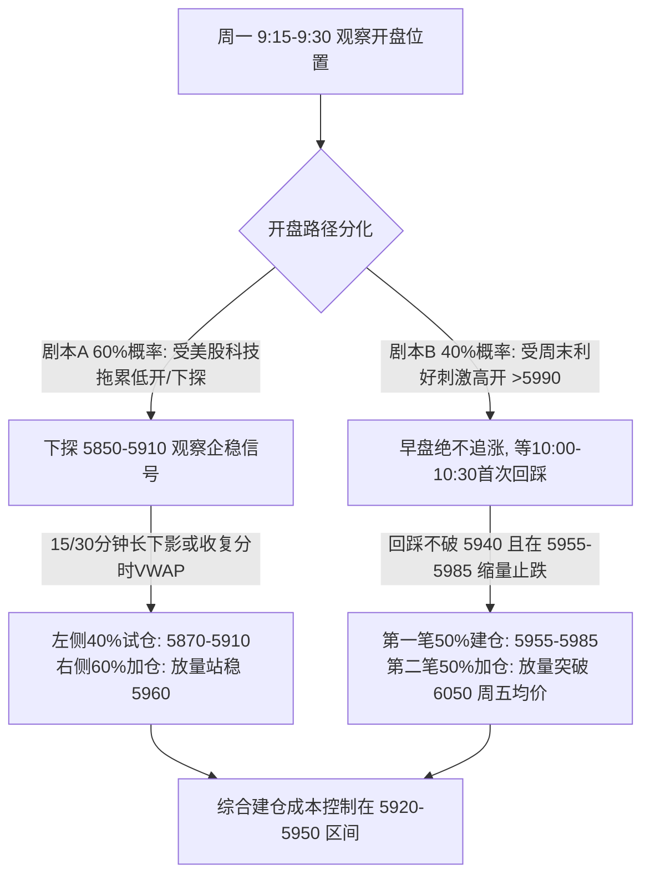

> [!abstract] 核心摘要
> - **数据截止**：2026-10-30（周五）15:00 收盘（美股数据截至美东 10-30 收盘；政策消息截至北京时间 2026-11-01 23:30）。
> - **关联前序研判**：[[2026-10-17 市场Price-in研判与A股反弹路径(IM2703)]] | [[2026-10-26 A股回调到位判断与加仓复盘(IM2703)]]
> - **核心结论**：下周（11/02–11/06）A股迎来“国内政策工具催化 vs 海外美股芯片暴跌补跌”的剧烈博弈。**上证指数周内反弹概率约 65%–70%，但双创与小盘股在周一/周二早盘先顺势下探的概率约 60%**。针对 **IM2703**，当前 20 日均线乖离率达 **-9.56%**、贴水 **-222.43 点（年化贴水 9.41%）**，具备极佳的 **“Delta 超跌反弹 + 基差收敛”** 双重波段做多（Swing Long）赔率，但**严禁周一早盘集合竞价追高**，最佳策略是等待早盘海外利空宣泄后的右侧回升确认或左侧分批承接。

---

## 一、周末多空因子拆解与历史“政策底—市场底”校验

### 1.1 周末核心催化与外部逆风

| 维度 | 核心事件与核实口径 | 对下周盘面的实际传导逻辑 |
| :--- | :--- | :--- |
| **国内政策催化（利好）** | 1. **央行、证监会拟于 11月2日（周一）上午召开座谈会**，召集部分券商、基金公司研究推动资本市场支持工具（SFISF 互换便利等）落地使用； 2. **某国有大行计划向中国国新、中国诚通各新增 1,000 亿元**（合计 2,000 亿）股票回购增持专项再贷款授信额度； 3. 央行、证监会 10/30 党委会议定调维持适度宽松货币政策、全力稳市场稳预期。 | **现代国家队四路分工明确**：中央汇金作为“类平准基金”托底宽基 ETF（买面）；**中国国新 + 中国诚通**走商业银行“股票回购增持专项再贷款”接口，定向增持**央企及国产硬科技/算力芯片/半导体材料**（买点与线）。2025年4月（获批1,800亿）与2026年7月19日（官宣已投600亿）两次出手均成功确立阶段铁底（3,040点与3,741点）。 |
| **海外与宏观逆风（利空）** | 1. **美东 10/30（周五）费城半导体指数（SOX）暴跌 7.20%**，纳指跌 2.86%（英特尔跌超 28%、AMD 跌超 10%、英伟达跌 4.22%），发生在 A 股周五收盘之后； 2. **10 月国内制造业 PMI 回落至 49.3%**（环比降 0.8 个百分点）； 3. 美联储维持利率 3.75%–4.00% 不变，但 2 名委员主张继续加息，美 9 月 PCE 同比升至 3.6%。 | 美股芯片股周五晚间的暴跌尚未被 A 股完全计价，**周一早盘光模块、算力、半导体及科创/中证 1000 极大概率面临情绪性低开或下探测试**。 |

### 1.2 历史参照系：打破两个常见认知误区

> [!warning] 认知纠偏：破除“固定天数见底”的机械倒计时
> 1. **“政策底后固定 1–2 周（或 5–8 个交易日）见市场底”不成立**：
>    - 历史上政策底到市场底跨度极大：2008 年约 1.5 个月（9/18 至 10/28 的 1,664 点）、2018 年约 2.5 个月（10/19 至次年 1/4 的 2,440 点，但空间仅差 0.4%）、2023–2024 年初逾半年；
>    - 近年也有**低点先于或同步于政策/座谈会**的案例：2024 年 2 月是 2/5 先见底 2,635 点、2/6 汇金扩围，2/18–19 才开座谈会；2025 年 4 月 7 日关税冲击当天汇金出手即见底 3,040 点；
>    - **最直接的近端参照是 2026 年 7 月 19 日（周日）国新诚通官宣 600 亿增持 + 7 月 20 日（周一）证监会座谈会**：周一（7/20）市场并未直接暴涨，中证 1000 反而低开收跌 -2.83%，直至**周二（7/21）早盘二次探底 6,714 点后才走出单日 +4.23%（日内振幅 +8.1%）的深 V 反转**。
> 2. **“授信额度” $\neq$ “即时买盘”**：
>    - 本次 2,000 亿系媒体报道的银行新增**授信额度**，而非已交割买盘。若要复制 7 月 21 日级别的强力反转，下周需看到 **多路资金单周合计净流入 1,000 亿–1,500 亿元**（其中宽基 ETF 净申购 500 亿–800 亿+、国新诚通实际提款买入及机构 SFISF 落地 300 亿–500 亿+）。

---

## 二、中证 1000 与 IM2703 盘面微观结构快照（截至 2026-10-30 收盘）

| 指标维度 | 中证1000 现货 (`000852.SH`) | **IM2703（下季核心合约）** | IM2612（下月主力） | 上证指数 (`000001.SH`) | 结构定性与交易含义 |
| :--- | :---: | :---: | :---: | :---: | :--- |
| **10/30 收盘价** | **6,161.23** (-3.41%) | **`5,938.8`** (-3.59%) | 6,081.0 (-3.75%) | 3,599.02 (-1.44%) | 中证 1000 光脚阴线收于全天最低；IM2703 结算价 **5,989.8** |
| **10/30 开 / 高 / 低** | 6,243.98 / 6,428.58 / **6,161.23** | 6,018.8 / **6,218.0** / **5,935.6** | 6,160.2 / 6,368.0 / 6,081.0 | 3,605.65 / 3,660.21 / 3,595.26 | IM2703 周五全天均价（VWAP）为 **`6,048.3`** |
| **相对 10/23 低点位置** | **已跌破** 10/23 低点（6,301.81） | **已跌破** 10/23 低点（6,053.0） | 已跌破 | **未破** 10/23 低点（3,574.27） | 小盘成长提前杀穿前低释放风险，上证 50（周五仅跌 -0.75%）抗跌护盘 |
| **期现基差（贴水）** | 基准 | **贴水 `-222.43 点` (-3.61%)** | 贴水 -80.23 点 (-1.30%) | — | 距 2027-03-19 到期 140 天，**IM2703 年化贴水率达 `9.41%`** |
| **均线系统与乖离率** | MA5: **6,435.21** (-4.26%) MA10: **6,573.43** (-6.27%) MA20: **6,812.88** (**`-9.56%`**) | 折合 MA5: **~6,212.8** 折合 MA10: **~6,351.0** 折合 MA20: **~6,590.5** | — | MA5: 3,655.55 MA10: 3,680.56 MA20: 3,735.83 | 中证 1000 距 20 日均线负乖离接近 **-10%**，处于极度超卖区 |
| **波动率与流动性** | 成交额 3,384.5 亿元 **14日 ATR: `223.03 点` (3.62%)** | 成交 5.26 万手（636.4 亿） **持仓量: `10.42 万手`** | 成交 27.55 万手 持仓 30.47 万手 | 沪市成交 7,642.3 亿元 | IM2703 流动性充裕；但日均波幅高达 223 点，需采用**宽止损+低杠杆** |

---

## 三、IM2703 波段交易（Swing Long）两套入场执行剧本

> [!important] 核心执行铁律
> **周一（11月2日）9:30 开盘前 15–30 分钟内严禁无脑追高！** 必须先观察市场如何消化周五美股费城半导体指数 -7.2% 的隔夜冲击，以及上午央行/证监会座谈会的盘中资金反馈。

### 剧本 A（主推最优情景，主观概率 60%）：早盘顺势下探诱空，恐慌衰竭后建仓
- **盘面特征**：受美股芯片股暴跌传导，周一早盘科创 50 与中证 1000 低开或快速下探，IM2703 跌破周五低点（5,935.6），测试 **`5,850 – 5,910`** 区间（对应中证 1000 现货测试 `6,070 – 6,130`，逼近 6,000–6,050 整数心理关口）。
- **分批执行**：
  - **第一笔（40% 底仓，左侧承接）**：在 **`5,870 – 5,910`** 区间出现 15 分钟级别下影线且中证 1000 ETF（`512100` / `159845`）放量托盘时挂单买入；
  - **第二笔（60% 确认仓，右侧加仓）**：盘中放量拉升收复周五收盘价并站稳 **`5,960`**（或有效站上当日分时均价线 VWAP）时追入；
  - **目标持仓均价**：**`5,920 – 5,935`**。

### 剧本 B（次优情景，主观概率 40%）：受政策预期刺激直接高开于 5,990（周五结算价）上方
- **盘面特征**：集合竞价直接高开在 5,990–6,030 区间，但早盘遭遇科技股获利/解套盘抛压回落。
- **分批执行**：
  - **第一笔（50% 仓位，回踩承接）**：等待早盘 10:00–10:30 第一波回踩，只要**不跌破 `5,940`（周五收盘价）**且在 **`5,955 – 5,985`** 缩量止跌，介入半仓；
  - **第二笔（50% 仓位，突破加仓）**：结合上午央行/证监会座谈会消息，若午后放量突破并站稳 **`6,050`**（周五全天成交均价 `6,048.3`），右侧打满剩余半仓。

---

## 四、止损、保本上移与三级分批止盈点位表

以基准建仓均价 **`5,930`**、合约乘数 **200 元/点** 测算：

| 操作节点 | **IM2703 触发点位** | 对应中证1000现货 | 距成本点数 (幅度) | 单手盈亏金额 | 技术结构与微观逻辑依据 |
| :--- | :---: | :---: | :---: | :---: | :--- |
| **硬止损位 (Hard Stop)** | **`5,770.0`** *(30分钟收盘破位或盘中破5,750)* | **~5,980** *(跌破6,000大关)* | **-160.0 点** (-2.70%) | **-3.20 万元/手** | 现货有效跌破 6,000 点整数大关，表明海外科技崩盘引发新一轮多杀多踩踏、政策托底失效，无条件止损离场 |
| **时间止损 (Time Stop)** | **周三(11/04)收盘 < `5,950`** | < 6,170 | 约持平 | 约 0 元 | 政策催化后 3 个交易日仍无法收复周五失地，“该涨不涨理应看跌”，主动平仓规避阴跌 |
| **移动保本线 (Breakeven)** | 盘中触及 **`6,060.0`** 后触发 | ~6,280 | +130.0 点 | **锁定保本** | 价格越过周五均价线（6,048.3）后，立即将止损单上移至 **`5,940`（成本+10点）**，消除本金亏损风险 |
| **第一止盈位 (TP1，平 40%)** | **`6,130.0 – 6,150.0`** | **6,320 – 6,350** | **+200 ~ +220 点** (+3.54%) | **+4.0 ~ +4.4 万元/手** | **10/23 前低（现货 6,301.8）顶底转换颈线位** + 周四低点（6,378）下方筹码密集区，首波超跌反弹极易在此震荡 |
| **第二止盈位 (TP2，平 40%)** | **`6,215.0 – 6,240.0`** | **6,428 – 6,450** | **+285 ~ +310 点** (+5.02%) | **+5.7 ~ +6.2 万元/手** | **周五最高点（IM2703 为 `6,218.0` / 现货 `6,428.58`）+ 5日均线（6,435）共振压力位**，叠加贴水收敛至 -180 点左右 |
| **第三止盈位 (TP3，留 20%)** | **`6,350.0 – 6,380.0`** *(配合100点移动止盈)* | **6,550 – 6,580** | **+420 ~ +450 点** (+7.34%) | **+8.4 ~ +9.0 万元/手** | **10日均线（6,573）+ 10/28 反弹高点（现货 6,578 / IM2703 约 6,398）强阻力带**；需千亿级增量资金共振方可触及 |

> [!tip] 数学期望与赔率核算
> - 单笔风险敞口 $R_{\text{loss}} = 160\text{ 点}$（3.2 万元/手）；
> - 三级目标赔率分别为 **TP1 ($1.31:1$)**、**TP2 ($1.86:1$)**、**TP3 ($2.72:1$)**；
> - 按 `40% / 40% / 20%` 仓位加权，综合期望盈亏比 **$R_{\text{win}}/R_{\text{loss}} \approx 1.81 : 1$**；叠加触及 `6,060` 后的保本上移机制，实战风险收益结构极佳。

---

## 五、仓位风控与盘中实时监控 Checklist

- [ ] **名义杠杆硬约束（$\le 2.5\times$）**：
  IM2703 在 `5,930` 点位单手名义价值为 **$5,930 \times 200 = 118.6\text{ 万元}$**。由于当前 14 日 ATR 高达 223 点/天，**每交易 1 手 IM2703，账户需配置至少 `50万 – 80万元` 权益资金**（使单手 3.2 万元硬止损严格控制在账户总资金的 $4\% \sim 6\%$ 以内；若大资金组合则单笔风险控制在总净值的 $1.5\% \sim 2.0\%$）。
- [ ] **盘中做多确认信号（加仓/持有底气）**：
  1. **宽基 ETF 脉冲放量**：早盘急跌或午后 13:30–14:30，**中证1000 ETF（`512100` / `159845`）**、**科创50 ETF（`588000`）** 出现连续大额主动买单（单只双创宽基 ETF 日成交维持百亿以上）；
  2. **远月贴水主动收敛**：IM2703 贴水从周五的 `-222.4 点` 快速收窄至 **`-180 点` 以内**，伴随中信、国君席位空单减仓；
  3. **硬科技抗跌脱敏**：中国国新重仓方向（国产算力芯片如海光信息、半导体材料、央企科技 ETF）无视美股芯片股大跌，率先翻红领涨。
- [ ] **盘中防守撤退信号（减仓/离场预警）**：
  1. 周一反弹极度缩量（两市成交额萎缩至 1.4 万亿以下），且 IM2703 贴水反而走阔至 **`-240 点` 以上**；
  2. 周一晚间美股费城半导体指数继续破位大跌，引发周二早盘二次恐慌且跌破周一低点；
  3. **可选尾部对冲方案**：若持有多头底仓过夜且担心外围黑天鹅，可按 **$1\text{ 手 IM2703 多单} : 0.5\text{ 手 IH2703（或 IF2703）空单}$** 进行跨品种对冲，剥离大盘系统性贝塔，纯吃“超跌小盘弹性 + 远月贴水收敛”的 Alpha。

---

## 六、进阶滚动操作：触及 TP1～TP3 后的回踩安全判定与再入场（Re-entry）矩阵

在首波脉冲阳线（Leg 1）分批止盈后，通过良性回踩（First Pullback）将已平仓位安全接回以博弈主升二浪（Leg 2），须严格执行以下**四维正交安全判定准则**与**三级接回点位矩阵**。

### 6.1 回踩安全性的四维正交判定标准（缺一不可）

1. **空间黄金分割回撤（Fibonacci Retracement）**：
   以起涨低点 $L_0$（假设基准为 `5,890`）至阶段止盈高点 $H_n$ 的波段涨幅 $\Delta = H_n - L_0$ 测算：
   - **极强安全区（$0.382\Delta$ 回撤）**：多头承接极强，首选接回位；
   - **标准安全区（$0.50\Delta$ 回撤）**：多空平衡枢轴及突破颈线顶底转换位，最后加仓防线；
   - **失效放弃区（有效跌破 $0.618\Delta$）**：30 分钟收盘跌破 $0.618$ 分位，定性为超跌死猫跳（Dead Cat Bounce），严禁接回，剩余底仓准备离场。
2. **量价结构（Volume Dry-Up 缩量洗盘）**：
   - 回踩过程中 15/30 分钟阴线成交量须较上涨脉冲阳线**萎缩 30%–40% 以上**；两市全天成交额较冲高日温和缩量 10%–20%（但维持在 1.5 万亿上方），严防“冲高缩量、下杀放量”的派发结构（如 10/27 教训）。
3. **期指微观基差韧性（Basis Resilience）**：
   - **安全信号**：现货回落时，**IM2703 跌幅小于现货，贴水不扩大甚至继续收敛**（稳定在 `-170` 至 `-190` 点以内），且伴随减仓下行（获利多单平仓而非空头主力增仓打压）；
   - **危险信号**：回踩时 IM2703 贴水迅速走阔至 `-220 点` 以上且增仓下杀，立即放弃接回。
4. **右侧 K 线触发扳机（Trigger）**：
   - 严禁在急跌第一根大阴线中左侧盲接飞刀；须等待价格进入支撑带后，**15 分钟或 30 分钟 K 线收出底分型（长下影锤子线、阳包阴或双十字星企稳）** 且分时重回当日均价线（VWAP）上方时右侧敲单。

### 6.2 TP1 / TP2 / TP3 止盈后回踩接回点位与风控矩阵

> 注：下表按起涨低点基准 $L_0 \approx 5,890$ 测算（若实际起涨低点为 `5,930`，各回撤支撑位相应上移 30–40 点）。

| 情景阶段 | 阶段高点参考 | 前序已执行动作 | **安全回踩接回区 (IM2703)** | 对应中证1000现货 | 核心技术重合支撑依据 | **二次接回止损位** | 接回后博弈目标位 |
| :--- | :---: | :--- | :---: | :---: | :--- | :---: | :---: |
| **情景 1：触及 TP1 后回踩** *(首波脉冲遇阻洗盘)* | **`6,140`** *(现货 ~6,330)* | 已平 40% 留 60% 底仓 | **`6,025 – 6,055`** *(回撤 0.382~0.50)* | `6,220 – 6,250` | ① **10/30 全天成交均价线 (`6,048.3`)** 顶底转换； ② 10/30 开盘缺口 (`6,018.8`) 上沿； ③ 首波 250 点涨幅之 $38.2\% \sim 50\%$ 分位 | **`5,980.0`** *(跌破周五结算价 5,989.8 及 0.618 分位)* | 先看前高 **`6,140`**，突破直看 **TP2 (`6,225`)** |
| **情景 2：触及 TP2 后回踩** *(反包周五阴线后回踩)* | **`6,225`** *(现货 ~6,435)* | 累计已平 80% 留 20% 底仓 | **`6,100 – 6,135`** *(回撤 0.27~0.382)* | `6,290 – 6,325` | ① **TP1 颈线区 (`6,130–6,150`) 阻力转强支撑**； ② 现货 **10/23 前低 (`6,301.8`)** 生命线； ③ 动态上移后的 5 日均线支撑 | **`6,045.0`** *(跌破 0.50 分位 `6,057` 及周五均价线)* | 重看 **`6,225`**，突破直看 **TP3 (`6,365`)** |
| **情景 3：触及 TP3 后回踩** *(主升反转浪换手)* | **`6,365`** *(现货 ~6,570)* | 仅留 20% 或已全平 | **`6,185 – 6,220`** *(回撤 0.30~0.382)* | `6,380 – 6,430` | ① **TP2 突破口（10/30 最高点 `6,218.0`）顶底转换**； ② 10/29 现货低点 (`6,378`) 筹码支撑； ③ 5 日与 10 日均线金叉共振带 | **`6,120.0`** *(跌破 TP1 颈线及 0.50 分位 `6,127`)* | 向上博弈 **20日均线（现货 `6,810` / IM2703 约 `6,600`）** |

### 6.3 滚动加仓（Re-entry）三大资金管理铁律

> [!danger] 严防“倒金字塔加仓”把首波利润吐光
> 1. **等额或递减回补，绝不超额扩仓**：
>    - 在 **TP1 (`6,140`)** 止盈平掉 40% 后，回踩 `6,025 – 6,055` 最多只接回这 **40% 仓位**（总仓位恢复至 100%，严禁加到 120%+）；
>    - 在 **TP2 (`6,225`)** 累计止盈 80% 后，回踩 `6,100 – 6,135` 建议仅接回 **40%–50% 仓位**（总仓位控制在 60%–70%），位置越高越靠近 20 日均线强阻力，敞口须逐级收敛。
> 2. **用“已实现利润（Realized PnL）”锁定整轮战役安全垫**：
>    - 例如 TP1 平仓 40% 已锁定相当于总仓位 $+210 \times 40\% = +84\text{ 点}$ 的落袋利润；在 `6,040` 接回 40% 仓位并设 `5,980` 止损（单笔风险 60 点），即便二次加仓触发止损，仅消耗总仓位 $60 \times 40\% = 24\text{ 点}$ 利润，**整轮交易仍净赚 $+60\text{ 点}$ 以上**，确保立于不败之地。
> 3. **“事不过三”横盘限时原则**：
>    - 若接回仓位后，价格在支撑位与前高（如 `6,040 – 6,140`）之间箱体震荡超过 **2 个交易日** 仍无法向上突破，说明多头动能衰竭，须在第二次摸高颈线附近果断平掉接回仓位，防范久盘必跌风险。
