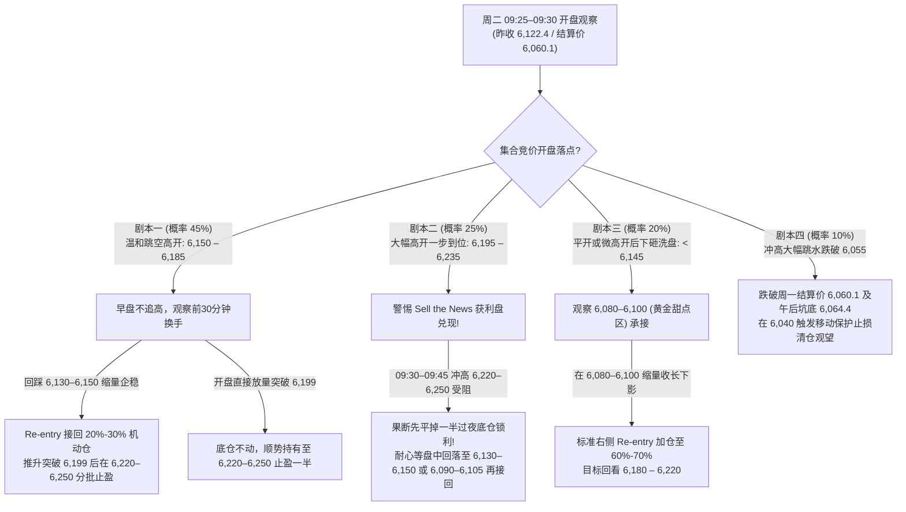

# 2026-11-03（周二）A股与 `IM2703` 波段交易作战方案及多情景预案

> [!abstract] 盘前核心交易员判断（Swing Trader's Executive View）
> 1. **多空天平已向多头倾斜，但周二切忌“无脑追高开”**：
>    周一（11月2日）A股走出教科书级的**“早盘破底翻（Spring）+ 午后回踩确认 + 放量收复颈线”**反转结构；周一晚 20:04 央行三部门重磅落地**“回购增持再贷款利率由1.25%降至1.00%并转为长期制度性安排 + 周二启动超1,000亿SFISF第三次招标”**，叠加周一夜盘美股纳指反弹 `+1.32%`、富时A50夜盘上涨 `+0.33%`，周二早盘高开是大概率事件。
> 2. **周二最大的微观博弈点——“早盘利好兑现抛压 vs. SFISF增量进场承接 + 周三美国中期选举避险”**：
>    周一早盘在 `5,925–5,960` 抄底的资金单手浮盈已近 200 点（4万元/手），且美东时间周二晚（北京时间周三上午）即迎来美国中期选举计票。因此，**周二若直接大幅高开顶到 `6,218–6,245`（周五高点+枢轴R1阻力带），极易触发日内高抛洗盘；反之，回踩 `6,130–6,150`（强势浅回踩）或 `6,080–6,100`（标准0.382回踩）则是极佳的滚动接回（Re-entry）良机。**
> 
> 前置关联笔记：
> - [[2026-11-02 近期A股密集救市与稳市场政策时间线复盘及深度评述]]
> - [[2026-11-01 A股政策底与市场底复盘及下周波段交易计划(IM2703)]]
> - [[2026-10-26 A股回调到位判断与加仓复盘(IM2703)]]

---

## 一、11月2日（周一）收盘及夜盘最新基准数据校准

在制定周二点位前，先锁定周一 15:00 收盘与 23:45 夜盘的精确锚点数据：

| 标的 / 指标 | 开盘价 | 最高价 | 最低价 | 收盘价 (涨跌幅) | 动态均线 / 关键微结构参数 |
| :--- | :---: | :---: | :---: | :---: | :--- |
| **中证1000 (`000852.SH`)** | `6,197.38` | `6,373.94` | `6,136.52` | **`6,329.34`** (`+2.73%`) | 成交 **3,554.7亿**（放量）；**MA5 = `6,374.92`**（周一高点精准受阻处！），**MA10 = `6,536.54`**，**MA20 = `6,764.64`** |
| **IM2703 股指期货** | `5,990.4` | `6,199.0` | `5,925.0` | **`6,122.4`** (`+2.21%`) | 较周五收盘价 (`5,938.8`) 实涨 **`+183.6点`**；**全天结算价/均价 VWAP = `6,060.1`**；午后黄金坑底 = **`6,064.4`**；持仓 `103,027手`；收盘基差 `-206.94点`（盘中一度收敛至 `-174.9点`） |
| **上证指数 (`000001.SH`)** | `3,614.31` | `3,648.13` | `3,594.77` | **`3,638.03`** (`+1.08%`) | 沪市成交 **8,474.6亿**；**MA5 = `3,643.65`**，**MA10 = `3,671.27`**，**MA20 = `3,726.55`** |
| **科创50 (`000688.SH`)** | `1,185.51` | `1,209.97` | `1,155.94` | **`1,196.94`** (`+3.11%`) | 成交 **813.1亿**；**MA5 = `1,224.22`**，**MA10 = `1,277.37`** |
| **外围夜盘 (23:45 CST)** | — | — | — | **A50: `12,905`** (`+0.33%`) | **纳斯达克100 (`NDX`) 大涨 `+1.32%`**（扭转周五半导体恐慌） |

### 量化点位推导（基于周一全天振幅 `5,925.0 → 6,199.0`，$\Delta = 274.0\text{ pts}$）
- **全天波段斐波那契回撤**：`0.236` = **`6,134.3`** ｜ `0.382` = **`6,094.3`** ｜ `0.500` = **`6,062.0`** ｜ `0.618` = **`6,029.7`**
- **午后主升浪（`6,064.4 → 6,199.0`，$\Delta = 134.6\text{ pts}$）回撤**：`0.382` = **`6,147.6`** ｜ `0.500` = **`6,131.7`** ｜ `0.618` = **`6,115.8`**
- **周二经典枢轴点（Floor Pivots）**：中心枢轴 $P = \mathbf{6,082.1}$ ｜ 第一阻力 $R_1 = \mathbf{6,239.3}$ ｜ 第二阻力 $R_2 = \mathbf{6,356.1}$ ｜ 第一支撑 $S_1 = \mathbf{5,965.3}$

---

## 二、周二（11月3日）核心观测点位地图（止盈区 vs. 安全 Re-entry 区）

> [!important] 关键技术共振发现
> 1. **上方 `6,220 – 6,245` 是极强的一级止盈共振带**：周五起跌最高点 (`6,218.0`) + 现货周五高点 (`6,428.58`) + 周二枢轴第一阻力位 $R_1$ (`6,239.3`) 三重重合！
> 2. **下方 `6,060 – 6,065` 是惊人的“三重铁底”**：周一全天结算价/VWAP (`6,060.1`) + 全天波段 `0.50` 二分位 (`6,062.0`) + 周一13:14午后洗盘低点 (`6,064.4`) 误差仅 4 个点完全重合！只要不破这里，多头波段趋势坚如磐石。

### 1. 上方减仓/止盈观测标尺（Take-Profit & Resistance Levels）

| 点位层级 | `IM2703` 区间 | 对应中证1000现货 | 技术与筹码含义 | 交易执行动作 |
| :--- | :---: | :---: | :--- | :--- |
| **第一道关口（突破确认位）** | **`6,195 – 6,205`** | `6,374 – 6,385` | 周一盘中最高点 (`6,199.0`) + **现货动态 5日均线 (`6,374.92`)** + 10/29现货低点 (`6,378.01`) | **观察突破力度**：若放量站稳 `6,200` 且贴水收敛至 `<-180` 点，持有待涨看 TP2；若缩量冲高三次不过，可先T出 20% 机动仓 |
| **核心减仓止盈区（TP2 ★）** | **`6,220 – 6,250`** | `6,415 – 6,440` | 周五暴跌起跌最高点 (`6,218.0` / 现货 `6,428.58`) + **周二枢轴阻力 $R_1$ (`6,239.3`)** | **主力止盈减仓位**：无论是早盘高开直抵还是盘中推升触及，**果断减仓止盈 40%–50%**，锁定波段丰厚利润！ |
| **进阶延伸止盈区（TP3）** | **`6,345 – 6,385`** | `6,535 – 6,560` | **现货动态 10日均线 (`6,536.54`)** + 10/29高点 (`6,538.05`) + **枢轴 $R_2$ (`6,356.1`)** | **波段终极目标区**（通常需周二SFISF放量+周三美中期选举利好共振触达）：仅留 **20% 尾仓** 配合 80 点移动止盈博弈 |

---

### 2. 下方安全回调与加仓接回标尺（Safe Pullback & Re-entry Levels）

判断周二盘中回调是否属于**“安全的良性洗盘”**，必须同时满足：**① 15分钟回落缩量（成交量较早盘冲高柱萎缩 35%+）；② `IM2703` 贴水不恶化（维持在 `-175 ~ -205` 点，不出现恐慌性贴水走阔至 `-230` 点以上）。**

| 回调级别 | `IM2703` 接回区间 | 对应中证1000现货 | 多重技术共振依据 | Re-entry 加仓建议与止损锚点 |
| :--- | :---: | :---: | :--- | :--- |
| **Level 1：强势浅回踩** *(高开回踩缺口上沿)* | **`6,130 – 6,150`** | `6,325 – 6,345` | 全天 `0.236` 回撤 (`6,134.3`) + 午后浪 `0.382~0.50` 回撤 (`6,131.7~6,147.6`) + 周一午盘价 (`6,144.2`) | **适用于早盘冲高 `6,185+` 后的首次回踩**：出现5m/15m下影线企稳时，可接回 **20%–30%** 机动仓做日内正T |
| **Level 2：黄金甜点回踩 ★** *(最理想的波段加仓位)* | **`6,080 – 6,100`** | `6,285 – 6,305` | 全天 `0.382` 黄金分割 (`6,094.3`) + **周二中心枢轴 $P$ (`6,082.1`)** + **现货 10/23 颈线 (`6,301.81`)** | **赔率与胜率最佳的 Re-entry 区**：若早盘平开洗盘或冲高回落至此缩量止跌，果断把仓位加回至 **60%–70%**！ |
| **Level 3：极限机构成本垫** *(多头最后防守铁底)* | **`6,055 – 6,068`** | `6,255 – 6,270` | **周一全天结算价/VWAP (`6,060.1`)** + 全天 `0.50` 回撤 (`6,062.0`) + **周一午后黄金坑底 (`6,064.4`)** | 左侧轻仓试探的极限下沿；**全仓硬性保护止损设在 `6,040.0`**（有效跌破三重铁底则无条件离场保住周一胜利果实） |

---

## 三、周二（11月3日）四种开盘与盘中演变剧本及交易执行方案

### 剧本一：温和跳空高开，回踩缺口后震荡推升（基准情景，概率 `45%`）
- **盘面特征**：受昨晚再贷款降息至 `1%` 及美股纳指反弹提振，`IM2703` 早盘温和开在 **`6,150 – 6,185`**（现货开在 `6,350 – 6,370`，紧贴 5日均线下方）。开盘后短线获利盘兑现，小幅回踩测试 `6,130 – 6,150` 不破，随后在 SFISF 机构买盘与科创/硬科技带动下放量突破 `6,199.0`。
- **操作方案**：
  1. **开盘前 15 分钟（9:30–9:45）**：手里的 `40%–50%` 过夜底仓**按兵不动，绝不在开盘脉冲第一分钟追高加仓**；
  2. **早盘回踩窗口（9:45–10:30）**：若如期回踩 **`6,130 – 6,150`** 缩量止跌并重返分时均价线（VWAP），用昨天腾出的现金 **Re-entry 加仓 `20%–30%`**；
  3. **午后冲高止盈**：当价格突破 `6,199` 攻入 **`6,220 – 6,250`（TP2 区）** 时，把今天加的机动仓连同部分底仓平掉，锁定日内差价！

### 剧本二：情绪过热大幅高开，一步顶到阻力区后高开低走（脉冲兑现情景，概率 `25%`）
- **盘面特征**：集合竞价多头情绪亢奋，`IM2703` 直接开在 **`6,195 – 6,235`**（现货直接跳过 5日均线开在 `6,390 – 6,425`）。由于一步到位触及周五暴跌高点套牢区（`6,218`），周一抄底盘与量化资金大举高抛，走出“高开回落补缺”走势。
- **操作方案（反人性高抛做 T）**：
  1. **早盘果断锁利**：只要集合竞价或开盘前 15 分钟直接冲进 **`6,215 – 6,250`**，如果 5 分钟 K 线出现放量长上影或跌破开盘前 5 分钟低点，**立刻先止盈一半过夜底仓（将仓位降至 20%–25%）**，先把昨晚政策红利变成真金白银装进口袋！
  2. **下午低吸接回**：高开回落洗盘通常会在 **`6,130 – 6,150`**（第一档）或 **`6,090 – 6,110`**（第二档）企稳，等下午 13:30 后缩量止跌时再把早上高抛的仓位接回来。

### 剧本三：克制平开/微高开，早盘先向下洗盘再拉起（先蹲后跳情景，概率 `20%`）
- **盘面特征**：市场因顾忌明早美国中期选举结果，开盘谨慎（`6,120 – 6,145`），早盘顺势向下洗出昨晚追消息的散户多头，回踩至 **`6,080 – 6,100`**（现货回踩 `6,290–6,305` 即 10/23 颈线）。
- **操作方案**：
  1. **底仓稳拿不慌**：只要不跌破 `6,055`，绝不被早盘洗盘震出局；
  2. **精准低吸（Sweet Spot Re-entry）**：当 `IM2703` 落入 **`6,080 – 6,100`** 区间，看到 15 分钟 K 线缩量收下影线且基差维持在 `-200` 点以内时，**分两笔买回 `25%–30%` 仓位**，止损统一放在 `6,040.0`，博弈午后 SFISF 招标公告落地后的深V拉升。

### 剧本四：放量冲高回落并击穿 `6,055` 铁底（防范黑天鹅失效情景，概率 `10%`）
- **盘面特征**：利好落地后全天买盘衰竭，大资金借利好持续派发，午后放量跌穿周一结算价 **`6,060.1`** 与午后低点 **`6,064.4`**，现货重新跌回 `6,250` 以下。
- **操作方案**：
  - 这是典型的“重大利好不涨反跌（该涨不涨理应看空）”警示信号。一旦 15 分钟收盘有效跌破 **`6,040.0`**，**无条件触发全仓移动保护止损清仓离场**，保住周一的大额利润，等周三美国中期选举靴子落地后再重新评估。

---

## 四、周二尾盘（14:50）隔夜仓位铁律：衔接周三美国中期选举

> [!warning] 周三（11月4日）上午 09:00–14:00 是美国中期选举计票实时跳动窗口！
> 明天（周二）下午 **14:50 收盘前**，无论日内做 T 多么顺利，都必须执行**“选前夜仓位风控校准”**：
> - **周二收盘建议留仓比例：`35% – 45%`（不超过半仓，名义杠杆控制在 $\le 1.0\times$ 左右）**。
> - **逻辑**：目前民调与预测市场显示民主党夺回众议院概率高达 `91%–95%`、赢下参议院概率 `64%`（对A股属风险出清偏利好），但交易员永远不在开牌前夜赌满仓。留 **40% 左右底仓 + 充足现金**：
>   - 若周三上午计票确认民主党拿下众议院/横扫两院，市场放量突破 **`6,240`**，可右侧顺势追击看 **`6,350–6,385`（TP3）**；
>   - 若周三盘中计票出现摇摆州胶着引发瞬时剧烈下影线洗盘，手里的 60% 现金正好在盘中急跌时从容捡便宜筹码！
