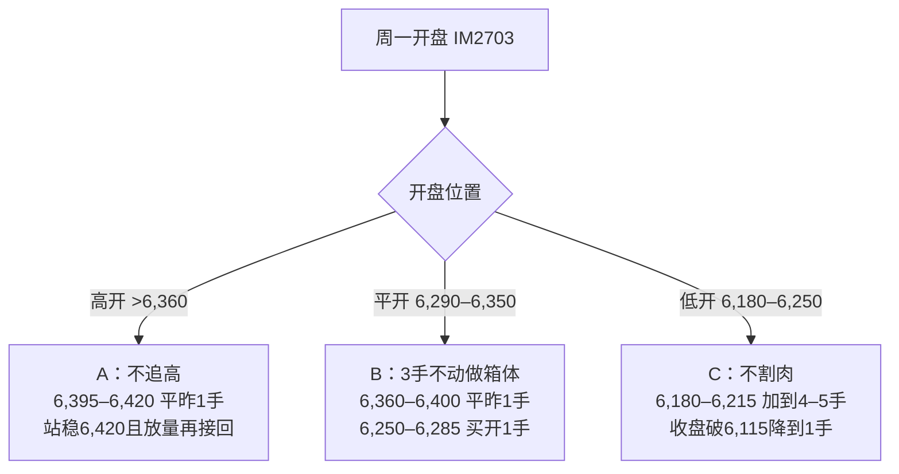

# 周度复盘与下周（11.09–11.13）IM2703 均线夹板波段计划

> 前序笔记：[[2026-11-01 A股政策底与市场底复盘及下周波段交易计划(IM2703)]] · [[2026-11-03 A股与IM2703周二波段交易作战方案及多情景预案]] · [[2026-11-02 近期A股密集救市与稳市场政策时间线复盘及深度评述]]

## 一、本周（11.02–11.06）收盘定格

| 标的 | 上周五收盘 (10/30) | 周低 | 周高 | 周五收盘 | 周涨幅 |
| :--- | :---: | :---: | :---: | :---: | :---: |
| `IM2703` | 5,938.8 | 5,925.0 | 6,503.0 | **6,317.6**（结算 6,335.9） | **+6.38%** |
| 中证1000 `000852` | 6,161.23 | 6,136.52 | 6,700.84 | **6,505.35** | **+5.59%** |
| 科创50 `000688` | — | — | — | 1,253.20 | 约 +7.85% |
| 上证指数 | — | — | — | 3,649.18 | 约 +1.39% |

- 周五收盘贴水：`IM2703` 约 **-187.8 点**（上周五为 -222.4 点，贴水在收敛）；`IM2612` 收 6,464.0。
- `IM2703` 持仓量：周五全天增仓 +5,106 手，收在 107,245 手（周末前有对冲盘进场）。
- 周五盘面：隔夜美股大跌（纳指 -5.52%，费城半导体 -12% 以上），`IM2703` 以开盘价当日最低 6,250 开盘，最高拉到 6,409，尾盘跌破全天均价 6,335.9 收在 6,317.6。

### 本周节奏回顾
- 周一：低开扫掉 5,925 后反弹到 TP1，午后回踩 6,064 后再次拉升。
- 周二：外汇存款准备金率上调叠加两融担保比例压力，下探 5,983。
- 周三：美国中期选举落地叠加长鑫回购，逼空到 6,366（TP3）。
- 周四：开盘即最低 6,266.6，最高 6,503（TP4），冲高后回落。
- 周五：消化美股暴跌冲击，6,250 到 6,409 的区间内做 T。

## 二、均线结构（中证1000现货，数据截至 11.06 收盘）

| 日期 | 收盘 | MA5 | MA10 | MA20 | MA60 |
| :--- | :---: | :---: | :---: | :---: | :---: |
| 11-04 | 6,511.81 | 6,320.5 | 6,455.1 | 6,670.1 | 7,300.8 |
| 11-05 | 6,650.14 | 6,374.8 | 6,462.3 | 6,645.7 | 7,286.7 |
| 11-06 | 6,505.35 | **6,443.6** | **6,439.4** | **6,613.1** | 7,269.7 |

- **11.06 MA5 上穿 MA10**：这是 10 月中旬下跌以来第一次金叉。
- **更正**：60 日线在 **7,269.7**，下周触及不到。上方的关键阻力是 20 日线和本周高点 6,700.8。

### 下周均线推演（假设指数横在 6,505 不动）

| 交易日 | MA5 | MA10 | MA20 |
| :--- | :---: | :---: | :---: |
| 周一 11/09 | 6,478.8 | 6,426.8 | 6,587.3 |
| 周二 11/10 | 6,535.6 | 6,434.7 | 6,561.4 |
| 周三 11/11 | 6,534.3 | 6,427.4 | 6,541.4 |
| 周四 11/12 | 6,505.4 | 6,440.0 | 6,532.8 |
| 周五 11/13 | 6,505.4 | 6,474.5 | 6,523.9 |

> [!important] 核心结论
> MA5 在周一、周二会抵扣掉 6,329 和 6,221 两个低位收盘价，因此快速上拐。MA20 前三天每天下移 20–26 点，后两天放缓到约 9 点。
> **周三前后 MA5 与 MA20 在现货 6,535–6,545 附近粘合**，对应 `IM2703` 约 **6,345–6,360**（按贴水约 188 点换算），这是下周的变盘窗口。

## 三、周一三种开盘剧本（以 3 手底仓为基准）

| 剧本 | 触发条件 | `IM2703` 操作 | 对应中证1000现货 |
| :--- | :--- | :--- | :--- |
| **A 高开** | 美股周五夜盘企稳 | 第一次摸到 **6,395–6,420**（周一 MA20 约在 6,400）先平昨 1 手；30 分钟站稳 6,420 且两市成交 2 万亿以上再接回 | 约 6,585–6,610 |
| **B 平开** | 开在 6,290–6,350 | 箱体操作：上沿 **6,360–6,400** 平昨 1 手，下沿 **6,250–6,285** 买开 1 手 | 上沿约 6,550–6,590，下沿约 6,440–6,475 |
| **C 低开** | 美股继续下跌 | **6,180–6,215** 是右底区（周三结算价 6,181.2 加上周波段 0.5 分位 6,214），可加到 4–5 手；**收盘跌破 6,115 降到 1 手** | 右底约 6,370–6,405，止损约 6,300 |

> [!warning] 手续费顺序
> 日内做 T 一律**先平昨、后买开**，避免触发平今手续费（约为平昨的 10 倍）。当天新开的仓位如果需要对冲，用 `IM2612` 反向开仓锁住，不要直接平今。

## 四、周三、周四方向判定

- **向上确认（第二波启动）**：现货收盘站上 **6,560**（`IM2703` 约 6,375），两市成交 2 万亿以上，科创50 站上 1,290–1,300。
  - 目标：本周高点现货 **6,700**，对应 `IM2703` 约 6,503–6,510。
  - 回踩 **6,360–6,380** 可以加仓。
- **向下确认（继续夹板震荡）**：碰到 20 日线后回落，MA5 重新跌破 MA10。
  - 回到剧本 B 的箱体下沿，等右底出现。既不扛单，也不加仓。

## 五、下周关键价位速查

| 类别 | `IM2703` | 中证1000现货 | 依据 |
| :--- | :---: | :---: | :--- |
| 强阻力 | 6,395–6,435 | 6,585–6,615 | 周一 MA20、周五高点 6,409、周四结算价 6,434.6 |
| 日内阻力 | 6,336–6,365 | 6,530–6,555 | 周五全天均价、周五横盘平台 |
| 第一支撑 | 6,245–6,285 | 6,415–6,465 | MA5/MA10 金叉区、周五开盘低点 6,250、本周波段 0.382 分位 6,282 |
| 右底区 | 6,180–6,215 | 6,350–6,390 | 周三结算价 6,181.2、本周波段 0.5 分位 6,214、周一高点 6,199 |
| 结构止损 | 6,115 | 约 6,300 | 本周波段 0.618 分位 6,145.8、周三前高 6,129 |

## 六、仓位纪律

1. **上限 5 手**。周五 6 手的名义市值约 760 万元，每 10 点盈亏 1.2 万元，波动太大。
2. **底仓 2–3 手**不轻易动，只用平昨额度做 T。
3. **周五收盘前**照例把仓位降回 2–3 手过周末。
4. 收盘跌破 6,115 时，无论是什么剧本都降到 1 手。

## 七、周末待观察

- [ ] 周五夜盘美股和费城半导体能否止跌（决定周一走剧本 A 还是剧本 C）
- [ ] 周末国内是否有新的 SFISF 投放或增量政策
- [ ] 周日晚上根据最新消息确定周一的挂单点位
