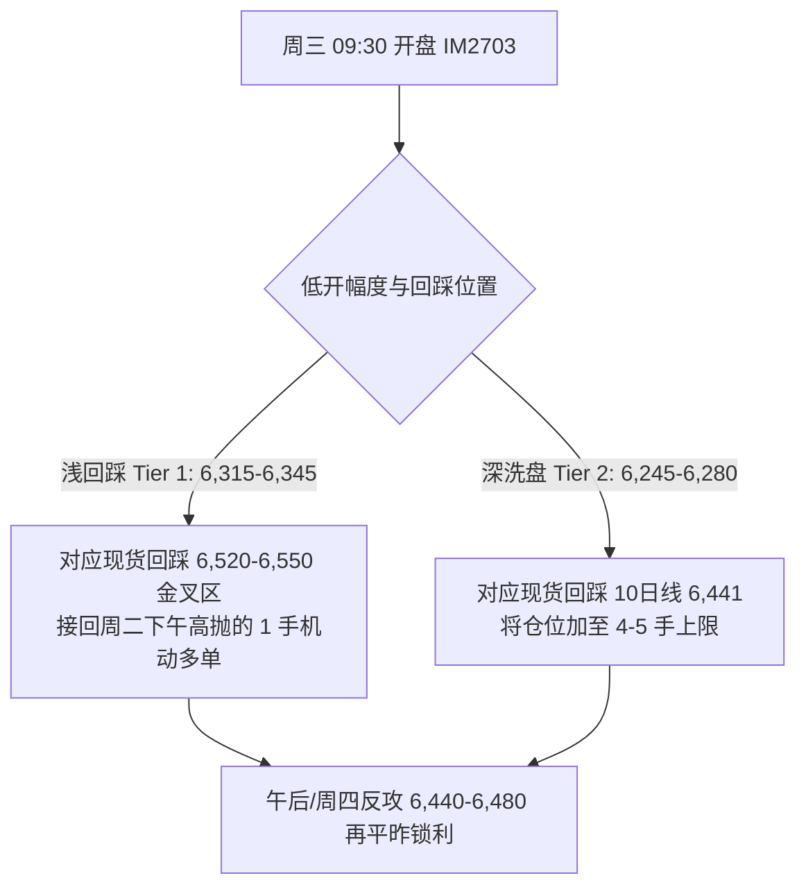

# 美国10月CPI复盘与周三（11.11）A股及 IM2703 波段作战计划

> 前序笔记：[[2026-11-06 周度复盘与下周(11.09-11.13)IM2703均线夹板波段计划]] · [[2026-11-03 A股与IM2703周二波段交易作战方案及多情景预案]] · [[2026-11-01 A股政策底与市场底复盘及下周波段交易计划(IM2703)]]

## 一、今晚（11.10 21:30）美国 10 月 CPI 与核心宏观信号拆解

### 1. 美国 10 月 CPI 核心细项：“名义略超预期、核心符合预期，触及联储鹰派警戒线”
- **整体 CPI（Headline CPI）**：**环比 +0.4%**（市场预期 +0.3%，前值 +0.6%），高于预期 0.1 个百分点。
  - **食品项**：环比 **+0.5%**（居家食品 +0.4%，外出就餐 +0.5%）。
  - **能源项**：环比 **+0.7%**（前值 +5.2%，其中汽油环比 +1.0%，电力环比 +0.9%，管道天然气 -0.8%）。
- **核心 CPI（Core CPI，剔除食品与能源）**：**环比 +0.3%**（市场预期 +0.3%，前值 +0.3%），连续第 3 个月（8月、9月、10月）卡在 +0.3% 的偏高平台。
  - **住房（Shelter）**：环比 **+0.3%**（前值 +0.4%），贡献了当月整体 CPI 涨幅的 30% 以上（其中等价租金 OER +0.3%，主要居所租金 +0.2%，离家住宿 +0.6%）。
  - **其他服务与商品**：医疗保健商品环比 **+0.5%**、交通运输服务环比 **+0.8%**；二手车和卡车环比 **-1.2%**。
- **特殊背景（同比数据缺席）**：因 2025 年 10 月美国联邦政府停摆导致 BLS 当月未能采集价格样本，本次官方罕见未发布整体与核心 CPI 同比（YoY）增速，市场定价完全锚定环比折年率。
- **政策含义**：在数据公布前 4 小时，美联储理事沃勒（Waller）公开释放强鹰信号，指出若 10 月核心 CPI 环比维持在 0.3% 或更高，将证明通胀偏离目标，支持 12 月继续加息（甚至讨论 50bp）。今晚 **整体 +0.4% / 核心 +0.3%** 的组合锁定了美联储 12 月鹰派基调，压制美股高估值成长股分母端。

### 2. 数据公布后全球跨资产即时反应（21:48 截点）
- **汇率与大宗**：美元指数（DXY）直线拉升 **+0.31% 至 101.985**（盘中摸高 102.05）；COMEX 黄金期货跌 **-1.20% 至 4,065 美元/盎司**。
- **美股期指与半导体盘前**：
  - 纳指 100 期货（NQ）自盘前高点 28,109 回落约 390 点至 **27,712（-1.08%）**；标普 500 期货（ES）报 **7,531（-0.57%）**；
  - 美股半导体盘前回吐昨日暴涨获利盘：`SMH` 盘前 **-2.19%（476.75）**、`SOXX` 盘前 **-2.45%（143.16）**、`AMD` 盘前 **-2.00%（498.40）**、应用材料 `AMAT` 盘前 **-2.63%（360.79）**、英伟达 `NVDA` 盘前 **-1.84%（175.39）**、台积电 `TSM` 盘前仅微跌 **-0.41%（386.93）**。
- **中国离岸资产（显著抗跌，独立性凸显）**：
  - **富时中国 A50 期指（CHA50CFD）** 仅微跌 **-0.27%（12,881点）**；
  - **中国大盘股 ETF（FXI）** 盘前 **+0.03%（34.66）**、**中概互联 ETF（KWEB）** 盘前 **+0.29%（24.37）**。

### 3. 产业基本面强催化与日程修正
- **台积电 10 月营收创单月历史新高**：今日午后台积电公布 2026 年 10 月合并营收达 **新台币 5,868.9 亿元（环比 +14.7%，同比暴增 +59.7%）**，1–10 月累计营收约 4.49 万亿新台币。全球先进制程与晶圆代工景气度处于极高水位。
- **海外财报时间窗口校准**：
  1. **明晨（11月11日周三 05:10 北京时间）**：北美算力租赁核心指标股 **CoreWeave（CRWV）** 发布 Q3 财报（美股周二盘后），直接影响明日 A 股海外光模块（中际旭创）与液冷（英维克）情绪。
  2. **本周四（11月12日）**：港股盘后 **中芯国际（00981.HK / 688981.SH）** 发布 Q3 财报；美东时间周四盘后 **应用材料（AMAT）** 发布 FY26 Q4 财报。

---

## 二、周二（11.10）A股收盘定格与周三（11.11）均线金叉推演

### 1. 周二（11.10）收盘核心数据与尾盘 30 分钟复盘

| 标的 | 周一收盘(或昨结) | 周二最高 | 周二最低 | 周二 14:30 价 | **周二 15:00 收盘** | 日涨跌幅 | 成交额 / 持仓量 |
| :--- | :---: | :---: | :---: | :---: | :---: | :---: | :---: |
| **`IM2703` 期货** | 6,308.4 (结) | **6,444.8** | 6,370.0 | 6,402.4 | **6,373.2** | **+1.03%** | **103,987 手** (较午盘+4,734手) |
| **`IM2612` 主力** | 6,448.6 (结) | **6,588.2** | 6,513.4 | 6,546.4 | **6,516.6** | **+1.05%** | **280,266 手** (较午盘+15,218手) |
| **中证1000 `000852`** | 6,499.74 | **6,625.52** | 6,560.59 | 6,597.33 | **6,579.36** | **+1.22%** | 3,127.5 亿 (两市合计 15,048 亿) |
| **科创50 `000688`** | 1,256.96 | **1,291.09** | 1,262.25 | 1,270.92 | **1,265.02** | **+0.64%** | 660.2 亿 |
| **创业板指 `399006`** | 2,458.56 | **2,520.01** | 2,487.56 | 2,500.97 | **2,494.40** | **+1.46%** | 4,161.3 亿 |
| **上证指数 `000001`** | 3,660.79 | **3,683.73** | 3,660.72 | 3,668.88 | **3,663.72** | **+0.08%** | 6,739.5 亿 |

- **技术突破确认**：我们在 [[2026-11-06 周度复盘与下周(11.09-11.13)IM2703均线夹板波段计划]] 第四节定下的**“向上确认（第二波启动）”标准是：中证1000现货收盘站上 6,560 点（对应 `IM2703` 约 6,375 点）**。今天中证1000最高冲至 **6,625.52 点**（刺穿昨日 6,612 双平顶），收盘 **6,579.36 点** 正式站上 20 日均线（**6,564.85 点**）！
- **尾盘半小时（14:30–15:00）主动防震**：14:30 至 15:00 期间，短线资金赶在今晚美国 CPI 前主动回吐了约 20–30 点涨幅（`IM2703` 从 6,402.4 回落至 6,373.2，北方华创从 540.01 回落至 538.68），相当于**提前为明早应对美股 CPI 回调跌出了安全垫**。
- **期指主力增仓过夜**：`IM2612` 与 `IM2703` 在下午合计增仓近 **20,000 手** 过夜，且 `IM2703` 收盘贴水现货扩大至 **-206.16 点**，说明机构多头底仓坚定看好下半周突破行情。

### 2. 周三（11.11）均线抵扣与“MA5 金叉 MA20”精确测算

我们在上周五笔记中推演的**“周三前后 MA5 与 MA20 在现货 6,545 附近粘合金叉”**将在明天（11月11日）开盘正式兑现：

| 标的与代码 | 11/10 收盘价 | 11/10 MA5 | 11/10 MA20 | 明日(11/11) MA5 抵扣价 (11/04) | **明日(11/11) 动态 MA5** | **明日(11/11) 动态 MA20** | 均线结构定性 |
| :--- | :---: | :---: | :---: | :---: | :---: | :---: | :--- |
| **中证1000 `000852`** | **6,579.36** | 6,549.28 | 6,564.85 | 6,511.81 | **6,562.79 ↑** | **6,548.56 ↓** | **明日 MA5 正式金叉上穿 MA20！双均线在 6,548–6,563 构筑铁底** |
| **科创50 `000688`** | **1,265.02** | 1,265.47 | 1,284.00 | 1,265.47 | **1,265.38 →** | **1,278.23 ↓** | MA20 快速下移至 1,278，夹角收窄至 1% |
| **上证指数 `000001`** | **3,663.72** | 3,669.95 | 3,679.62 | 3,686.17 | **3,665.46** | **3,674.45 ↓** | 下方 10 日线 **3,652.78** 提供强支撑 |
| **半导体设备 `159516`** | **0.518** | 0.512 | 0.521 | **0.481 (低扣!)** | **0.520 ↑↑** | **0.517 ↓** | **明日 MA5 蛙跳至 0.520 并正式金叉 MA20 (0.517)！** |
| **科创半导体 `588170`** | **0.705** | 0.705 | 0.714 | 0.695 | **0.707 ↑** | **0.707 ↓** | **明日 MA5 与 MA20 在 0.707 毫米级重合金叉！** |
| **半导体ETF `512480`** | **0.785** | 0.782 | 0.792 | 0.772 | **0.786 ↑** | **0.789 ↓** | 双线粘合于 0.786–0.789 |
| **科创芯片 `588200`** | **0.853** | 0.850 | 0.869 | 0.856 | **0.849 →** | **0.864 ↓** | 5 日线稳守 0.850，10 日线在 0.827 |
| **北方华创 `002371`** | **538.68** | 548.00 | 539.73 | 535.50 | **548.64 ↑** | **537.32 ↓** | 明日 20 日线下移至 **537.32 元**，10 日线 **521.85 元** |
| **中微公司 `688012`** | **245.66** | 248.33 | 254.16 | 240.01 | **249.46 ↑** | **251.69 ↓** | 10 日线支撑 **234.48 元**，明日 MA5 逼近 MA20 |
| **中芯国际H `00981`** | **47.22** | 46.56 | 47.78 | 46.44 | **46.72 ↑** | **47.36 ↓** | 5 日线与 20 日线收敛于 **46.7–47.3 港元** |
| **安集科技 `688019`** | **211.34** | 209.01 | 187.73 | 207.00 | **209.88 ↑** | **188.68 ↑** | 强趋势多头排列，5 日线动态支撑 **209.9 元** |
| **英维克 `002837`** | **39.38** | 38.51 | 41.61 | 38.82 | **38.62 ↑** | **41.21 ↓** | 放量突破 MA5 (38.5) 与 MA10 (38.88)，剑指 MA20 (41.2) |
| **中际旭创 `300308`** | **471.00** | 479.55 | 577.44 | 533.38 (高扣) | **467.07 ↓** | **566.34 ↓** | 明日剔除 533.38 后 MA5 下移至 **467.1 元**（回到现价脚下） |

---

## 三、周三（11.11）盘面预判与 `IM2703` 波段作战方案

> [!important] 核心定调：早盘借美 CPI 顺势小幅低开洗盘（回踩双均线金叉点）= 本周第二次黄金低吸接回窗口！
> 1. **为什么不会深跌？** 第一，中国离岸资产（A50 仅 -0.27%、KWEB +0.29%）对美 CPI 脱敏；第二，今天 14:30–15:00 A 股已提前回落消化；第三，明日中证1000 与 `159516`、`588170` 全面迎来 **MA5 上穿 MA20 日线金叉**；第四，台积电 10 月营收同比 +59.7% 叠加周四中芯国际/应用材料财报预期托底。
> 2. **日内节奏推演**：周三早盘（09:30–10:15）受隔夜美股影响小幅低开回踩 **中证1000 现货 6,520–6,555 点（MA5/MA20 金叉支撑带）**，随后在机构多头护盘与半导体代工/设备带动下震荡走高，继续挑战 **6,625–6,700 点**。

### 1. 宽基与 `IM2703` 周三执行点位表

| 品种 | 周二收盘 | **周三低吸接回区 (Buy Zone)** | **波段止盈目标位 (TP1 / TP2)** | 具体执行指令 |
| :--- | :---: | :---: | :---: | :--- |
| **`IM2703` 期货** | **6,373.2** | **Tier 1：`6,315–6,345`** **Tier 2：`6,245–6,280`** | **TP1：`6,445–6,480`** **TP2：`6,510 / 6,650`** *(结构止损：6,180)* | • 周二下午在 `6,400–6,440` 高抛锁利的机动仓，明早低开至 **`6,315–6,345`**（对应现货 `6,520–6,550` 金叉区）直接买开接回； • 若极端情绪下探 **`6,245–6,280`**（现货 10 日线 `6,441`），加满机动仓；底仓 2–3 手不动。 |
| **中证1000 `000852`** ETF `512100` | **6,579.36** `2.680` | **指数：`6,515–6,555`** **ETF：`2.645–2.662`** | **TP1：`6,630–6,700`** **TP2：`6,880`** | 明日 MA5 (`6,562.8`) 金叉 MA20 (`6,548.6`)，早盘回踩金叉区把周二减掉的 1/3 波段仓接回。 |
| **科创50 `000688`** ETF `588000` | **1,265.02** `1.340` | **指数：`1,245–1,255`** **ETF：`1.318–1.328`** | **TP1：`1,290–1,310`** **TP2：`1,360`** | 台积电 10 月营收暴增 +59.7% 形成强支撑，回踩 `1,248–1,255` 低吸，放量突破明日 MA20 (`1,278`) 右侧顺势持有。 |

---

### 2. 半导体与 AI 算力核心标的周三操作执行表

| 梯队 | 标的名称与代码 | 周二收盘 (日高) | 明日动态均线锚点 | **周三低吸接回/加仓区** | **止盈目标位 (TP1 / TP2)** | 操盘逻辑与执行细节 |
| :--- | :--- | :---: | :---: | :---: | :---: | :--- |
| **核心底仓ETF** | **半导体设备ETF** `159516.SZ` | **0.518** *(0.532)* | **MA5: 0.520** **MA20: 0.517** | **Tier 1：`0.508–0.514`** **Tier 2：`0.495–0.502`** | **TP1：`0.535–0.550`** **TP2：`0.580–0.640`** | 明日剔除 0.481 后 MA5 跳升至 `0.520` 金叉 MA20 (`0.517`)。周二冲高 `0.528–0.532` 做 T 卖出的机动仓，明早低开在 **`0.508–0.514`** 无脑接回。 |
| **晶圆代工龙头** | **中芯国际 H股** `00981.HK` | **47.22** *(48.76)* | **MA5: 46.72** **MA20: 47.36** | **`45.80–46.60` 港元** *(MA5 与 MA10 支撑)* | **TP1：`48.80–50.00`** **TP2：`56.50–57.50`** | 台积电 10 月营收同比 +59.7% 印证代工高景气。周二在 `48.5+` 减掉的 1/4 机动仓，明早回踩 **`46.0–46.6` 港元** 接回，博弈周四（11/12）Q3 财报。 |
| **设备双雄** | **北方华创 `002371`** **中微公司 `688012`** | **538.68** **245.66** | 华创 MA20: `537.3` 中微 MA10: `234.5` | **华创：`528.0–536.0`** **中微：`238.0–243.0`** | **华创：`568–590`** **中微：`262–278`** | 周二尾盘已提前回踩洗盘，底仓一股不卖；明早若受美股 AMAT 盘前回调影响低开至 **`528–535` 元 / `238–242` 元**，直接用手头现金加仓，博周四晚 AMAT 财报。 |
| **强趋势材料/芯片** | **安集科技 `688019`** **拓荆科技 `688072`** **澜起科技 `688008`** | **211.34** **496.44** **154.80** | 安集 MA5: `209.9` 拓荆 MA5: `496.1` 澜起 MA5: `154.6` | **安集：`203.0–207.5`** **拓荆：`480.0–488.0`** **澜起：`149.5–152.5`** | **安集 TP2：`230–245`** **拓荆 TP1：`525–545`** **澜起 TP1：`164–168`** | • **安集**周二摸高 `215.00` 已完成 TP1 止盈 1/3，明早回踩 `204–207.5` 接回； • **澜起**明日剔除 `167.82` 高位抵扣价后 5 日线走平在 `154.6`，回踩 `150–152` 低吸。 |
| **弹性芯片ETF** | **科创半导 `588170`** **半导体ETF `512480`** **科创芯片 `588200`** | **0.705** **0.785** **0.853** | 588170 金叉: `0.707` 512480 MA5: `0.786` 588200 MA5: `0.849` | **588170：`0.688–0.696`** **512480：`0.772–0.778`** **588200：`0.838–0.845`** | **588170：`0.745`** **512480：`0.825`** **588200：`0.900`** | 三只 ETF 明日均线全部粘合收敛，底仓持有，周二高抛的机动仓在左侧支撑区挂单接回。 |
| **液冷与光模块** | **英维克 `002837`** **中际旭创 `300308`** | **39.38** **471.00** | 英维克 MA5: `38.62` 旭创 MA5: `467.07` | **英维克：`38.40–38.85`** **旭创：`448.0–458.0`** | **英维克：`41.6–43.2`** **旭创：`495–515`** | • **英维克**：日线底背离放量突破 MA5/MA10，回踩 `38.5–38.8` 坚定低吸加仓； • **中际旭创**：430 抄底已在 `474–488` 兑现大半，明早先看 05:10 CoreWeave 财报表现再决定是否在 `448–458` 接回。 |

---

## 四、周三（11.11）盘前 09:00 三步核对清单

1. **核对美股收盘位（05:00）**：观察纳斯达克综合指数（IXIC）收盘是否守住 **5 日均线（25,051 点）** 以及 `SMH` / `TSM` 是否走出低开高走阳线。
2. **核对 CoreWeave（CRWV）盘后财报表现（05:10）**：若 CRWV 资本开支指引超预期大涨，则早盘优先加仓 **英维克（002837）** 与 **中际旭创（300308）**；若指引不及预期，则将机动资金全部集中于 **半导体设备 ETF（159516）、中芯国际 H 股（00981.HK）和北方华创（002371）**。
3. **核对 09:30–10:00 `IM2612` / `IM2703` 持仓量**：只要早盘低开回踩 **`6,315–6,345`** 时，`IM2703` 持仓量维持在 **10.3 万手以上** 且分时放量拉起，即确认机构多头借低开洗盘吸筹，果断完成机动仓回补。
