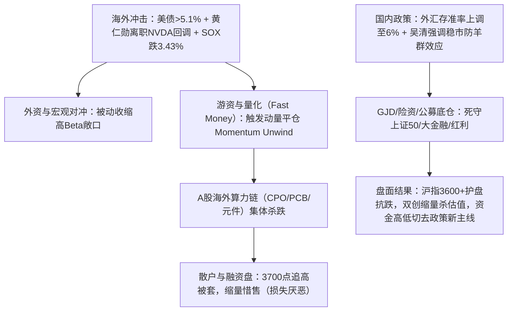

# 2026-11-15 周末全球宏观复盘与下周（11.16–11.20）A股波段交易计划

> [!abstract] 核心摘要与关联笔记
> - **数据截点**：A股截至 2026-11-13（周五）收盘；美股与大宗截至美东 2026-11-13（周五）收盘；周末政策与加密数据截至北京时间 2026-11-15 22:00。
> - **前序关联笔记**：[[2026-11-10 美国10月CPI复盘与周三A股及IM2703波段作战计划]] · [[2026-11-11 机器人与AI短剧题材SwingTrading研究报告]] · [[2026-11-06 周度复盘与下周(11.09-11.13)IM2703均线夹板波段计划]] · [[2026-11-01 A股政策底与市场底复盘及下周波段交易计划(IM2703)]]
> - **核心结论**：当前全球市场处于 **“美债收益率破 5.1% 抽紧分母端 + 英伟达换帅治理风波压制海外算力 + 国内央行稳汇率与产业政策托底”** 的三期叠加态。下周一（11月16日）A股大概率演绎 **“早盘海外映射惯性低开冰点 $\rightarrow$ 汇率与权重护盘托底 $\rightarrow$ 资金高低切涌入储能/创新药/国产替代”** 的探底回升剧本。全周核心变盘时间窗在 **周三（北京时间11月18日早盘，对应美东11月17日盘后英伟达财报落地）**。

---

## 一、周末核心消息面与跨资产全景复盘（截至 2026-11-15）

### 1.1 全球宏观与跨资产矩阵

| 资产类别 | 周五收盘 / 周末最新报价 | 核心驱动因子与波段定性 |
| :--- | :--- | :--- |
| **美债与美元** | 10Y美债收益率 **>5.10%**；美元指数创19个月新高 | 美国10月PPI同比 **+6.5%**（核心PPI维持5%左右高位），叠加前期10月CPI环比+0.4%，联储12月鹰派加息预期锁死，全球高估值与高杠杆资产遭遇分母端收缩。 |
| **美股宽基** | 道指 **52,347.55（+0.10%）** 标普500 **7,561.67（-0.40%）** 纳指 **25,136.27（-0.91%）** | 典型的**“道指抗跌、纳指回落”**高低切换；尽管周五科技股回调，三大指数全周仍录得 **+2.1% ~ +2.5%** 周线收涨。 |
| **半导体（SOX）与英伟达（NVDA）** | **SOX**：**10,146.32（-3.43%）** **NVDA**：**$162.85（-2.01%）**，盘后 **$161.04** | **关键人物折价（Key-Man Discount）**：创始人黄仁勋于11月12日突发辞职，CFO Colette Kress任临时CEO，股价较前期高点回撤超30%。市场静待 **美东11月17日（周二）盘后 Q3 财报大考**。 |
| **国际黄金** | 现货黄金 **$3,884–$3,940/盎司**（微幅整理） | 受5.1%美债收益率与强美元双重压制，金价周中跌破 $4,000 心理关口，短期从“避险/通胀交易”切换为**多头降杠杆后的低位震荡筑底**。 |
| **国际原油** | WTI **$88.56/桶（-0.20%）** 布伦特 **$95.84/桶** | 美伊局势紧张及霍尔木兹海峡航运扰动提供地缘溢价支撑；但接近 $90–$95 的高油价反过来强化了美国二次通胀担忧，形成压制科技股的宏观闭环。 |
| **加密货币（BTC）** | 比特币 **$66,970–$67,350**（跌破 $70,000 大关） | 现货ETF持续净流出 + 强美元抽水 + 全网多头高倍杠杆清算。作为全球游资风险偏好（Risk-On/Off）的先行指标，BTC破位7万关口预示全球 Fast Money 正在主动降杠杆。 |

### 1.2 英伟达（NVDA）风暴与下周二（11.17盘后）财报拆解
- **治理层巨震**：11月12日黄仁勋正式辞去CEO及董事职务，CFO Colette Kress接任临时CEO，独立董事 Harvey C. Jones 出任首设董事长，董事会正接触 Arm CEO Rene Haas 等潜在继任者。华尔街正在对 NVDA 进行从“创始人信仰溢价”向“治理不确定性折价”的估值重构。
- **11月17日盘后 FY27 Q3 财报核心看点**：
  1. **明牌业绩**：华尔街一致预期 Q3 营收 **1,080亿–1,090亿美元（同比 +90%）**，EPS 约 **$2.47**。由于Q3订单与交付在黄仁勋离职前已全部跑通，当季数字大概率靓丽。
  2. **真正胜负手（电话会指引）**：临时CEO Kress 对 **2028年远期订单能见度**、**Rubin架构后续路线图是否延宕**、**上游HBM涨价对毛利率的挤压**，以及北美云大厂与 CoreWeave 等算力租赁联盟资本开支（CapEx）可持续性的定调。

### 1.3 国内宏观、监管与产业政策汇总
1. **央行稳汇率重磅出手（上调外汇存准率）**：自 **2026年11月15日起**，金融机构外汇存款准备金率由 **4% 上调至 6%**，直接锁紧境内美元流动性、平抑人民币汇率波动，对冲美元指数19个月新高的外部冲击。
2. **央行开展 2,000 亿元买断式逆回购**：定于 **11月16日（周一）** 开展 2,000 亿元 6 个月期（180天）买断式逆回购操作，维持银行体系中长期流动性充裕，同时防止短端资金利率过度偏低空转。
3. **证监会主席吴清定调“六个进一步深化”**：在2026年中国资本市场学术年会上强调系统构建**“稳的机制、稳的力量、稳的生态”**，深入研究改善预期引导机制，**减少“羊群效应”带来的异常波动**；《衍生品交易监督管理办法（试行）》于11月16日正式施行；上交所周末点名重点监控“全球芯片LOF”等高溢价基金。
4. **两大产业强催化落地**：
   - **新型储能**：发改委、能源局印发《“十五五”新型储能实施方案》，明确到2030年全国新型储能装机达 **3亿千瓦**（新能源基地配储 5,000万–6,000万千瓦），重点突破大容量长时物理储能与低成本长时化学储能。
   - **创新药**：新版国家医保药品目录正式公布，新增107个药品，其中 **51款一类创新药纳入（创历史新高）**，**CAR-T 疗法实现医保“零突破”**。

---

## 二、A股近期走势归因：量价结构、参与者博弈与行为心理学

### 2.1 上周五（11.13）收盘定格与技术结构

| 指数/指标 | 11.13（周五）收盘 | 单日涨跌幅 | 全周涨跌幅 | 技术结构定性 |
| :--- | :--- | :--- | :--- | :--- |
| **上证指数** | **3,634.35** | -0.59% | -0.41% | 3700点关口受阻回落，退守 **3600–3630点** 箱体中枢支撑带 |
| **深证成指** | **10,968.79** | -2.05% | -1.85% | 跌破11000点整数关口，短期均线死叉 |
| **创业板指** | **2,426.08** | -3.32% | -1.59% | 受CPO/算力硬件拖累领跌，回踩中期均线支撑 |
| **科创50** | — | -2.30% | 周线微涨 | 芯片高标分歧加大，高位震荡消化获利盘 |
| **上证50 / 沪深300** | — | **+0.11%** / -0.68% | — | 银行、保险、白酒等大权重逆势护盘，“托而不举” |
| **两市成交额与个股** | **1.6557万亿元** | 较周四 **缩量 2,764亿** | 上涨 **764家** / 下跌 **>4,700家** | 典型**“缩量普跌、情绪冰点”**；元件（-6.29%）、CPO、PCB领跌 |

### 2.2 市场参与者结构与行为金融学剖析

1. **GJD / 险资 / 大型公募（底仓资金）——“政策锚定与年底锁盈”**：
   - 在吴清主席强调“稳的机制”与11月中旬各大券商2027年度策略会密集期，机构拒绝在3700点上方为游资接盘高拥挤度海外算力，而是利用银行、保险、上证50充当指数“稳定器”。
2. **量化与游资（Fast Money）——“反身性逆转与高低切”**：
   - 11月11日前后“易中天”等CPO板块曾因算力情绪修复大涨，筹码高度拥挤。黄仁勋突发离职打破了“算力信仰不可证伪”的单边叙事，引发游资“先跑为敬”并触发量化趋势策略的集中止损（Momentum Unwind）。
3. **散户与场内融资盘——“损失厌恶（Loss Aversion）与锚定效应”**：
   - 散户心理仍锚定在周四1.93万亿成交额的牛市预期中，周五缩量近2800亿且4700家下跌，表明大部分散户处于“浮亏装死、不愿割肉”状态。**这种缩量惜售意味着周一早盘若再受美股SOX大跌冲击，会逼出最后一批恐慌割肉盘（清洗浮筹），但随后反弹至3680–3700点时也会面临解套抛压。**

---

## 三、下周（11.16–11.20）及下周一A股走势预判

### 3.1 下周一（11月16日）日内分时三阶段推演

> [!tip] 周一核心剧本：**“早盘惯性冰点测试 $\rightarrow$ 汇率/权重托底回升 $\rightarrow$ 储能/创新药/国产替代结构性领涨”**

1. **第一阶段：早盘情绪冰点宣泄（09:15 – 10:00）**
   - **盘面表现**：受周五晚间 SOX 大跌 3.43%、NVDA 续跌 2% 传导，A股海外算力硬件（CPO、PCB、服务器）及高溢价跨境LOF/ETF周一大概率大幅低开，拖累创业板指与科创50惯性下探。
   - **交易心理信号**：上周五已出现 >4,700 家下跌的极致冰点，按照A股短线情绪周期律，**冰点次日早盘的恐慌低开往往是短线割肉盘的衰竭缺口（Exhaustion Gap），而非新一轮主跌段的起点**。
2. **第二阶段：政策托底与资金高低切（10:00 – 14:00）**
   - **汇率与指数防线**：6%外汇存准率生效 + 2000亿买断式逆回购落地，离岸人民币（USD/CNH）企稳将带动大金融与中字头护盘，**上证指数在 3,600–3,615 点具备极强支撑**。
   - **主线切换**：从“达链”撤出的活跃资金将在10:00后向上进攻周末两大政策明牌——**“十五五”新型储能（长时储能/电网设备）**与**新版医保目录（一类创新药/CAR-T）**，同时部分科技资金会回流**国产算力/信创（逻辑：海外治理危机强化国内供应链自主可控）**。
3. **第三阶段：尾盘修复定格（14:00 – 15:00）**
   - 预计周一沪指收出**探底回升的带下影线小阳线或十字星（核心波动区间 3,605 – 3,655 点）**，全天成交额预计在 **1.55万亿 – 1.70万亿元**。

### 3.2 下周全周节奏推演：“前低后稳，周三迎关键变盘窗”
- **周一至周二（11.16–11.17）**：市场在英伟达财报靴子落地前维持存量博弈（1.6万亿左右），特征为**“权重稳指数、杀海外映射、炒内需政策与国产替代”**。
- **周三（11.18，核心变盘日）**：北京时间周三凌晨（美东17日盘后）NVDA财报及电话会落地。无论结果如何，最大的不确定性都将消除，A股有望在周三前后完成二次回踩确认，开启面向年底的波段修复。

---

## 四、Swing Trader 实战投资建议与具体交易计划

### 4.1 仓位管理与资产配置总纲
- **建议总仓位**：**50% – 60%**（保留 40% 机动现金应对周三凌晨海外财报波动，待两市放量重回1.8万亿+再右侧加满）。
- **哑铃型仓位拆解**：
  - **25% 防守压舱石**：高股息红利 / 低估值金融（银行、保险、高PB-ROE央企）
  - **25% 政策催化右侧进攻**：新型储能（15%）+ 创新药/医药ETF（10%）
  - **10% 科技波段观察仓**：国产算力/自主可控 或 机器人/AI应用回踩核心标

### 4.2 四大板块具体作战计划（Actionable Playbook）

#### 1. 【头号进攻主线】“十五五”新型储能与长时储能
- **核心逻辑**：2030年3亿千瓦装机目标实锤，叠加周五新能源板块刚随大盘完成缩量洗盘，兼具“位置相对低 + 政策级别高 + 机构容量大”三大优势。
- **细分方向**：**大储PCS/逆变器、电网侧构网型储能、全钒液流/压缩空气等长时储能龙头**。
- **买卖点纪律**：
  - **禁手**：**严禁在周一 9:25 集合竞价顶一字或高开 >5% 时直接追高**（谨防量化资金借周末利好高开砸盘兑现）。
  - **买点（Entry）**：等待早盘 **10:00–10:30** 第一波兑现盘换手充分后，股价回踩分时均价线（VWAP）不破、且分时放量拐头向上时，分批建仓 **15% 仓位**。
  - **止损（Stop Loss）**：跌破上周五日K线最低价（或建仓成本 **-5%**）无条件止损。
  - **止盈（Target）**：波段目标 **+10% ~ +15%**，或短线冲高偏离5日均线 >8% 分批减半。

#### 2. 【困境反转波段】创新药与医疗产业链
- **核心逻辑**：51款一类创新药入保创历史纪录、CAR-T零突破，且上周五医疗服务板块处于缩量深跌的左侧超跌位，赔率极佳。
- **细分方向**：新纳入医保目录的**一类创新药企、ADC/CAR-T龙头**，或直接采用 **港股创新药ETF / 恒生医药ETF（支持T+0日内风控）**。
- **买卖点纪律**：
  - **买点（Entry）**：周一早盘若平开或小幅高开（<2%）可直接建底仓 **10%**；若盘中随大盘回踩5日/20日均线企稳，加至 **15%**。
  - **止损（Stop Loss）**：跌破近期箱体下沿支撑（约 **-4% ~ -5%**）。

#### 3. 【科技内部高低切】回避“达链”左侧飞刀，低吸国产算力/AI应用
- **核心逻辑**：
  - **坚决减仓/回避**：**海外算力链（CPO光模块、英伟达服务器及PCB）**。在周三凌晨NVDA电话会落地前，外资与公募风控处于强制降仓期。**持仓者应利用周一/周二盘中反抽5日均线的机会减仓至少50%**，绝不在周三前盲目“赌财报抄底”。
  - **右侧关注**：**国产算力芯片（信创/华为昇腾链）、具身智能机器人与AI垂直应用**（契合券商2027年度策略会“从海外硬件CapEx转向国产替代与ROI落地”的共识）。
- **买卖点纪律**：
  - 若周一早盘国产算力/科技成长被SOX大跌无差别带崩（低开 **-3% ~ -4%**），但在 **10:30前放量收复开盘价（形成“恐慌假摔”结构）**，可建 **10% 观察仓** 博弈周二、周三的资金回流。

#### 4. 【防守底仓】高股息红利与大金融（压舱石）
- **核心逻辑**：美债5.1% + 央行稳汇率 + 证监会防异常波动，上证50与高股息资产是机构四季度的天然避风港。
- **买卖点纪律**：**只低吸、不追涨**——仅在绿盘回踩10日/20日均线时低吸配置，切忌在指数护盘拉升时追高（防止周三后科技股企稳引发红利板块资金流出补跌）。

---

## 五、下周关键风控日历与盘面观察哨（Trader's Checklist）

- [ ] **周一（11.16）09:15–09:45**：观察 **离岸人民币（USD/CNH）** 在6%外汇存准率生效后的走势，以及央行 **2,000亿买断式逆回购** 对资金面（DR007）的稳定作用。
- [ ] **周一（11.16）10:30 盘中检验**：检查 **两市首小时成交额与跌停家数**。
  - *进攻信号*：首小时成交额 >7,000亿 且跌停家数 <15家 $\rightarrow$ 按计划执行储能/创新药右侧买点；
  - *防守信号*：沪指放量跌破 **3,600点** 且跌停家数 >40家 $\rightarrow$ 暂停一切新开仓，退守观望。
- [ ] **周三（11.18）早盘（美东11.17盘后）**：复盘 **英伟达 FY27 Q3 财报与临时CEO Kress 电话会**，重点确认 NVDA 盘后能否守住 **$150–$155** 长期趋势支撑位，以此决定周三至周五科技仓位的去留与加减。
