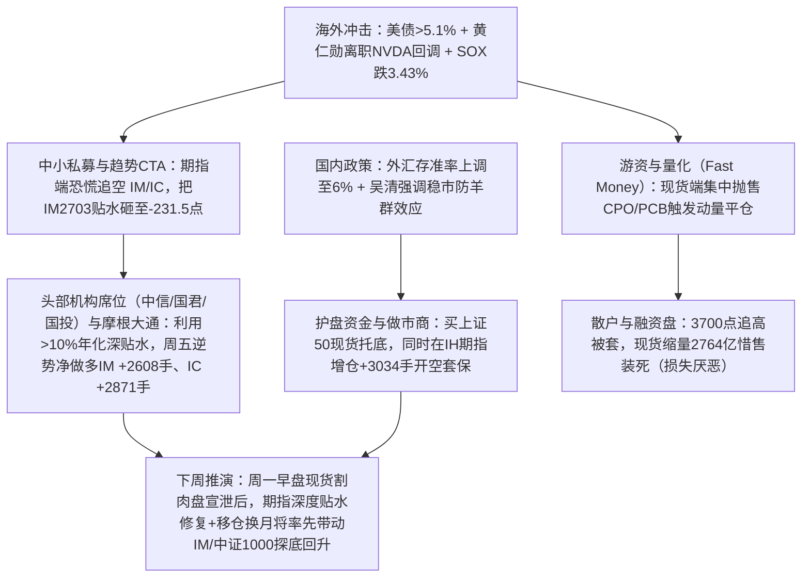

# 2026-11-15 周末全球宏观复盘与下周（11.16–11.20）A股波段交易计划

> [!abstract] 核心摘要与关联笔记
> - **数据截点**：A股截至 2026-11-13（周五）收盘；美股与大宗截至美东 2026-11-13（周五）收盘；周末政策与加密数据截至北京时间 2026-11-15 22:00。
> - **前序关联笔记**：[[2026-11-10 美国10月CPI复盘与周三A股及IM2703波段作战计划]] · [[2026-11-11 机器人与AI短剧题材SwingTrading研究报告]] · [[2026-11-06 周度复盘与下周(11.09-11.13)IM2703均线夹板波段计划]] · [[2026-11-01 A股政策底与市场底复盘及下周波段交易计划(IM2703)]]
> - **核心结论**：当前全球市场处于 **“美债收益率破 5.1% 抽紧分母端 + 英伟达换帅治理风波压制海外算力 + 国内央行稳汇率与产业政策托底”** 的三期叠加态。下周一（11月16日）A股大概率演绎 **“早盘海外映射惯性低开冰点 $\rightarrow$ 汇率与权重护盘托底 $\rightarrow$ 资金高低切涌入储能/创新药/国产替代”** 的探底回升剧本。全周核心变盘时间窗在 **周三（北京时间11月18日早盘，对应美东11月17日盘后英伟达财报落地）**。

---

## 一、周末核心消息面与跨资产全景复盘（截至 2026-11-15）

### 1.1 全球宏观与跨资产矩阵

| 资产类别 | 周五收盘 / 周末最新报价 | 核心驱动因子与波段定性 |
| :--- | :--- | :--- |
| **美债与美元** | 10Y美债收益率 **>5.10%**；美元指数创19个月新高 | 美国10月PPI同比 **+6.5%**（核心PPI维持5%左右高位），叠加前期10月CPI环比+0.4%，联储12月鹰派加息预期锁死，全球高估值与高杠杆资产遭遇分母端收缩。 |
| **美股宽基** | 道指 **52,347.55（+0.10%）** 标普500 **7,561.67（-0.40%）** 纳指 **25,136.27（-0.91%）** | 典型的**“道指抗跌、纳指回落”**高低切换；尽管周五科技股回调，三大指数全周仍录得 **+2.1% ~ +2.5%** 周线收涨。 |
| **半导体（SOX）与英伟达（NVDA）** | **SOX**：**10,146.32（-3.43%）** **NVDA**：**$162.85（-2.01%）**，盘后 **$161.04** | **关键人物折价（Key-Man Discount）**：创始人黄仁勋于11月12日突发辞职，CFO Colette Kress任临时CEO，股价较前期高点回撤超30%。市场静待 **美东11月17日（周二）盘后 Q3 财报大考**。 |
| **国际黄金** | 现货黄金 **$3,884–$3,940/盎司**（微幅整理） | 受5.1%美债收益率与强美元双重压制，金价周中跌破 $4,000 心理关口，短期从“避险/通胀交易”切换为**多头降杠杆后的低位震荡筑底**。 |
| **国际原油** | WTI **$88.56/桶（-0.20%）** 布伦特 **$95.84/桶** | 美伊局势紧张及霍尔木兹海峡航运扰动提供地缘溢价支撑；但接近 $90–$95 的高油价反过来强化了美国二次通胀担忧，形成压制科技股的宏观闭环。 |
| **加密货币（BTC）** | 比特币 **$66,970–$67,350**（跌破 $70,000 大关） | 现货ETF持续净流出 + 强美元抽水 + 全网多头高倍杠杆清算。作为全球游资风险偏好（Risk-On/Off）的先行指标，BTC破位7万关口预示全球 Fast Money 正在主动降杠杆。 |

### 1.2 英伟达（NVDA）风暴与下周二（11.17盘后）财报拆解
- **治理层巨震**：11月12日黄仁勋正式辞去CEO及董事职务，CFO Colette Kress接任临时CEO，独立董事 Harvey C. Jones 出任首设董事长，董事会正接触 Arm CEO Rene Haas 等潜在继任者。华尔街正在对 NVDA 进行从“创始人信仰溢价”向“治理不确定性折价”的估值重构。
- **11月17日盘后 FY27 Q3 财报核心看点**：
  1. **明牌业绩**：华尔街一致预期 Q3 营收 **1,080亿–1,090亿美元（同比 +90%）**，EPS 约 **$2.47**。由于Q3订单与交付在黄仁勋离职前已全部跑通，当季数字大概率靓丽。
  2. **真正胜负手（电话会指引）**：临时CEO Kress 对 **2028年远期订单能见度**、**Rubin架构后续路线图是否延宕**、**上游HBM涨价对毛利率的挤压**，以及北美云大厂与 CoreWeave 等算力租赁联盟资本开支（CapEx）可持续性的定调。

### 1.3 国内宏观、监管与产业政策汇总
1. **央行稳汇率重磅出手（上调外汇存准率）**：自 **2026年11月15日起**，金融机构外汇存款准备金率由 **4% 上调至 6%**，直接锁紧境内美元流动性、平抑人民币汇率波动，对冲美元指数19个月新高的外部冲击。
2. **央行开展 2,000 亿元买断式逆回购**：定于 **11月16日（周一）** 开展 2,000 亿元 6 个月期（180天）买断式逆回购操作，维持银行体系中长期流动性充裕，同时防止短端资金利率过度偏低空转。
3. **证监会主席吴清定调“六个进一步深化”**：在2026年中国资本市场学术年会上强调系统构建**“稳的机制、稳的力量、稳的生态”**，深入研究改善预期引导机制，**减少“羊群效应”带来的异常波动**；《衍生品交易监督管理办法（试行）》于11月16日正式施行；上交所周末点名重点监控“全球芯片LOF”等高溢价基金。
4. **两大产业强催化落地**：
   - **新型储能**：发改委、能源局印发《“十五五”新型储能实施方案》，明确到2030年全国新型储能装机达 **3亿千瓦**（新能源基地配储 5,000万–6,000万千瓦），重点突破大容量长时物理储能与低成本长时化学储能。
   - **创新药**：新版国家医保药品目录正式公布，新增107个药品，其中 **51款一类创新药纳入（创历史新高）**，**CAR-T 疗法实现医保“零突破”**。

---

## 二、A股近期走势归因：量价结构、参与者博弈与行为心理学

### 2.1 上周五（11.13）收盘定格与技术结构

| 指数/指标 | 11.13（周五）收盘 | 单日涨跌幅 | 全周涨跌幅 | 技术结构定性 |
| :--- | :--- | :--- | :--- | :--- |
| **上证指数** | **3,634.35** | -0.59% | -0.41% | 3700点关口受阻回落，退守 **3600–3630点** 箱体中枢支撑带 |
| **深证成指** | **10,968.79** | -2.05% | -1.85% | 跌破11000点整数关口，短期均线死叉 |
| **创业板指** | **2,426.08** | -3.32% | -1.59% | 受CPO/算力硬件拖累领跌，回踩中期均线支撑 |
| **科创50** | **1,279.66** | -2.30% | +2.11% | 周四摸高1364.88后回落，仍守在5日/10日线上方 |
| **中证1000 (`000852`)** | **6,357.26** | -2.76% | -2.28% | 周四摸高6723.80受阻，周五放量跌破MA5/MA20，最低6341.45测试前波段0.5分位 |
| **中证500 (`000905`)** | **6,465.49** | -2.10% | -2.00% | 跟随中小盘回调，回踩6450箱体支撑 |
| **上证50 / 沪深300** | **2,775.02** / **4,016.29** | **+0.11%** / -0.68% | -0.44% / -0.94% | 银行、保险、白酒等大权重逆势护盘，“托而不举” |
| **两市成交额与个股** | **1.6557万亿元** | 较周四 **缩量 2,764亿 (-14.3%)** | 上涨 **764家** / 下跌 **>4,700家** | 典型**“现货缩量普跌、情绪极致冰点”**；元件（-6.29%）、CPO、PCB领跌 |

### 2.2 中金所四大宽基股指期货（`IM / IC / IF / IH`）量仓结构、基差与龙虎榜拆解

> [!important] 核心微观信号：“现货缩量 -14.3% vs 期指逆势放量 +7.58%”的期现剪刀差
> 上周五（11.13）现货两市缩量2,764亿元（散户惜售装死），但**中金所四大期指总成交量却从周四的 65.95万手（8,331.3亿元）逆势放大至 70.95万手（8,756.4亿元），期现成交额比值从 43.2% 飙升至 52.9%！** 其中 `IM` 全系单日成交达 **356,380手（4,540.8亿元，创全周峰值）**、逆势增仓 **+13,407手** 至 **539,518手**。这证明机构、量化中性、CTA与外资在期指战场上进行了极其剧烈的换手与调仓博弈。

#### （1）全周（11.09–11.13）四大期指量仓与跨期基差演变表（中金所官方结算口径）

| 品种 / 合约 | 11/10 (周二) | 11/11 (周三) | 11/12 (周四) | **11/13 (周五)** | 周五成交量 (手) | 周五持仓量 (单日增减) | 周五收盘基差 (年化贴水率) |
| :--- | :---: | :---: | :---: | :---: | :---: | :---: | :---: |
| **`IM` 全系汇总** | 成交 25.53万 持仓 51.65万 | 成交 29.62万 持仓 52.79万 | 成交 31.88万 持仓 52.61万 | **成交 35.64万 (4,541亿)** **持仓 53.95万** | **356,380** *(V/OI = 0.66)* | **539,518** *(+13,407)* | 放量增仓杀跌，投机度全市场最高 |
| ├ `IM2611` (11.20交割) | 6,562.4 | 6,662.0 | 6,528.0 | **6,330.0** *(结 6,347.2)* | 63,537 | 81,382 *(+560)* | **-27.26** *(年化 ~22.4%)* |
| ├ `IM2612` (主力) | 6,516.6 | 6,623.0 | 6,480.4 | **6,276.8** *(结 6,295.0)* | **225,869** | **295,156** *(+6,049)* | **-80.46** *(年化 ~12.5%)* |
| ├ **`IM2703` (下季核心)** | 6,373.2 | 6,478.2 | 6,333.0 | **6,125.8** *(结 6,146.2)* | **48,885** | **111,249** *(+3,184)* | **-231.46** *(年化 ~10.4%)* |
| └ `IM2706` (隔季) | 6,209.2 | 6,313.6 | 6,164.2 | **5,958.0** *(结 5,972.0)* | 18,089 | 51,731 *(+3,614)* | **-399.26** *(年化 ~10.5%)* |
| **`IC` 全系汇总** | 成交 14.16万 持仓 29.53万 | 成交 15.67万 持仓 30.35万 | 成交 18.30万 持仓 30.34万 | **成交 18.89万 (2,436亿)** **持仓 30.27万** | **188,879** *(V/OI = 0.62)* | **302,667** *(-731)* | `IC2612` 收 **6,375.0** (基差 **-90.49**) `IC2703` 收 **6,227.6** (基差 **-237.89**) |
| **`IF` 全系汇总** | 成交 8.54万 持仓 31.66万 | 成交 9.28万 持仓 31.88万 | 成交 11.46万 持仓 32.23万 | **成交 11.55万 (1,379亿)** **持仓 31.94万** | **115,549** *(V/OI = 0.36)* | **319,422** *(-2,846)* | `IF2612` 收 **3,956.6** (基差 **-59.69**) `IF2703` 收 **3,885.4** (基差 **-130.89**) |
| **`IH` 全系汇总** | 成交 3.63万 持仓 10.09万 | 成交 4.11万 持仓 10.30万 | 成交 4.30万 持仓 10.11万 | **成交 4.87万 (401亿)** **持仓 10.42万** | **48,674** *(V/OI = 0.47)* | **104,171** *(+3,034)* | `IH2612` 收 **2,733.4** (基差 **-41.62**) `IH2703` 收 **2,689.8** (基差 **-85.22**) |

#### （2）11月13日（周五）龙虎榜前20席位持仓异动与四大参与者行为还原

| 品种 / 合约 | Top20多头持仓 (增减) | Top20空头持仓 (增减) | Top20净持仓 (净变化) | 核心机构与外资席位单日异动明细（11月13日） |
| :--- | :---: | :---: | :---: | :--- |
| **`IM` 全系 (4合约)** | **403,836** *(+15,579)* | **452,787** *(+12,971)* | **-48,951** ***(净多 +2,608!)*** | • **中信(代客)**：多 `82,974 (+5,356)` / 空 `119,759 (+3,150)` $\rightarrow$ **净做多 `+2,206手`** • **国君(代客)**：多 `76,383 (+5,832)` / 空 `77,317 (+4,691)` $\rightarrow$ **净做多 `+1,141手`** • **国投(代客)**：多 `24,507 (+958)` / 空 `11,480 (-227)` $\rightarrow$ **净做多 `+1,185手`** • **摩根大通**：`IM2612` 空单单日平仓 **`-704手`**（逢暴跌止盈空单） |
| ├ `IM2612` 主力 | 216,534 *(+7,356)* | 241,538 *(+6,530)* | -25,004 *(+826)* | 国君净多 `+1,378手`（多`+3,654`/空`+2,276`）、中信净多 `+792手`、国投净多 `+1,020手` |
| └ **`IM2703` 下季** | 79,213 *(+3,750)* | 94,796 *(+2,687)* | -15,583 *(+1,063)* | 国君净多 `+815手`（多`+1,454`/空`+639`）、海通多 `+828`、光大多 `+404`、瑞银多单锁仓 `1,924手` |
| **`IC` 全系 (4合约)** | **231,633** *(+2,452)* | **252,089** *(-419)* | **-20,456** ***(净多 +2,871!)*** | • **国君(代客)**：多 `+897` / 空 `-280`（**净做多 `+1,177手`**） • **中金财富** 净做多 `+862手`、**海通** 净做多 `+857手`、**东证** 净做多 `+824手` • **摩根大通**：`IC2703` 空单减仓 `-217手` |
| **`IF` 全系 (4合约)** | **247,923** *(0)* | **273,618** *(+582)* | **-25,695** *(-582)* | • **国君(代客)**：空单大减 `-1,784手`（**净做多 `+1,081手`**）；**东证** 净做多 `+863手` • **外资重仓远月多单**：**摩根大通** 在 `IF2703` 死守 **`6,685手` 多单（周五逆势 `+88手`，高居多头榜第4）**，`IF2706` 持有 **`1,518手` 多单**；**瑞银** 在 `IF2611` 持多 `2,531手` |
| **`IH` 全系 (3合约)** | **75,261** *(+3,162)* | **89,011** *(+3,044)* | **-13,750** *(+118)* | • **中信(代客)**：多 `+656` / 空 `+1,154`（**净加空 `-498手`**）；**国投** 空单 `+709手` • 揭示周五上证50现货护盘背后的**“买入现货ETF + 做空IH期指套保”**操作 |

**通过上述期指微观数据，我们可以精准还原四类核心参与者的真实行为：**

1. **为什么周五 `IM` 暴跌 `-3.14%` 且增仓 `+13,407手`，但前20大主力席位反而净做多 `+2,608手`？**
   - **真相是“散席/CTA追空砸出深贴水 vs 头部机构/指增席位逢低接多锁基差”**：周五盘中随着海外算力链崩溃，排在龙虎榜20名以外的中小私募、日内趋势CTA策略及部分恐慌对冲盘在午後不计成本市价追空，将 `IM2612` 基差从 `-57.4点` 砸到 **`-80.5点`**、`IM2703` 基差从 `-204.8点` 砸到 **`-231.5点`**（盘中最低 `6,110.2` 精准刺破前支撑后收回）。
   - 面对超过 **10.4%–12.5% 的年化贴水率**，以 **中信（净多+2,206手）、国君（净多+1,141手）、国投（净多+1,185手）** 为代表的头部机构席位（背后是中证1000指增、DMA多头置换及吃贴水策略）和外资 **摩根大通（平空704手）** 果断在下午进场充当对手盘，大举承接低位多单！同样的一幕也发生在 `IC` 上（前20席位单日净做多 `+2,871手`）。
2. **为什么周五现货 `上证50` 逆势收红 `+0.11%`，而 `IH` 期指却全线收跌、贴水翻倍（`-41.6点`）且逆势增仓 `+3,034手`？**
   - **真相是“GJD/机构现货托底 + 做市商期指端空头套保（期现套利）”**：周五护盘资金在现货市场买入上证50 ETF与银行权重维持沪指体面，但ETF做市商与绝对收益机构在承接一篮子权重股的同时，反手在 `IH2611`（增仓 `+1,288手`）和 `IH2612`（增仓 `+720手`）上开立空单锁住Delta风险（中信、国投席位在IH上明显加空）。**这说明权重的护盘带有强烈的“防御工具属性”，而非主动进攻。**
3. **长线外资（摩根大通 / 瑞银）的真实底牌是什么？**
   - 外资席位在 `IM/IC` 近月（`2611/2612`）上以量化市场中性空头对冲为主（且周五摩根大通在 `IM2612` 和 `IC2703` 上已开始逢低平空止盈）；但在代表中国核心资产的 **`IF2703` 和 `IF2706` 远季合约上，摩根大通合计重仓持有逾 `8,200手` 多单（名义本金近 100 亿元人民币）且周五还在逆势加多**，证明海外长线宏观资金对A股跨年及2027年一季度行情依然保持战略做多配置。
4. **下周特殊博弈：11月20日（周五）`2611` 合约交割周移仓换月（Rollover）效应**：
   - 截至周五收盘，`IM2611` 仍有 **`81,382手`** 巨量持仓未平（四大期指 `2611` 合约合计仍存 **17.78万手**）。下周一至周四是最后移仓窗口。
   - 由于周五 `IM2611 - IM2612` 跨期价差已拉大至 **`53.2点`**，`IM2612 - IM2703` 跨期价差达 **`151.0点`**，远月深度贴水导致**空头向远月移仓的年化损耗高达 12% 以上**。这将在下周形成**“空头移仓犹豫/被迫平近月空单 + 多头抢先移仓远月吃贴水”**的非对称博弈，对 `IM2612` 与 `IM2703` 的基差修复极为有利！

### 2.3 现货与期货全市场参与者行为心理学总表

---

## 三、下周（11.16–11.20）及下周一A股走势预判

### 3.1 下周一（11月16日）日内分时三阶段推演

> [!tip] 周一核心剧本：**“早盘惯性冰点测试 $\rightarrow$ 汇率/权重托底回升 $\rightarrow$ 储能/创新药/国产替代结构性领涨”**

1. **第一阶段：早盘情绪冰点宣泄（09:15 – 10:00）**
   - **盘面表现**：受周五晚间 SOX 大跌 3.43%、NVDA 续跌 2% 传导，A股海外算力硬件（CPO、PCB、服务器）及高溢价跨境LOF/ETF周一大概率大幅低开，拖累创业板指与科创50惯性下探。
   - **交易心理信号**：上周五已出现 >4,700 家下跌的极致冰点，按照A股短线情绪周期律，**冰点次日早盘的恐慌低开往往是短线割肉盘的衰竭缺口（Exhaustion Gap），而非新一轮主跌段的起点**。
2. **第二阶段：政策托底与资金高低切（10:00 – 14:00）**
   - **汇率与指数防线**：6%外汇存准率生效 + 2000亿买断式逆回购落地，离岸人民币（USD/CNH）企稳将带动大金融与中字头护盘，**上证指数在 3,600–3,615 点具备极强支撑**。
   - **主线切换**：从“达链”撤出的活跃资金将在10:00后向上进攻周末两大政策明牌——**“十五五”新型储能（长时储能/电网设备）**与**新版医保目录（一类创新药/CAR-T）**，同时部分科技资金会回流**国产算力/信创（逻辑：海外治理危机强化国内供应链自主可控）**。
3. **第三阶段：尾盘修复定格（14:00 – 15:00）**
   - 预计周一沪指收出**探底回升的带下影线小阳线或十字星（核心波动区间 3,605 – 3,655 点）**，全天成交额预计在 **1.55万亿 – 1.70万亿元**。

### 3.2 下周全周节奏推演：“前低后稳，周三迎关键变盘窗”
- **周一至周二（11.16–11.17）**：市场在英伟达财报靴子落地前维持存量博弈（1.6万亿左右），特征为**“权重稳指数、杀海外映射、炒内需政策与国产替代”**。
- **周三（11.18，核心变盘日）**：北京时间周三凌晨（美东17日盘后）NVDA财报及电话会落地。无论结果如何，最大的不确定性都将消除，A股有望在周三前后完成二次回踩确认，开启面向年底的波段修复。

---

## 四、Swing Trader 实战投资建议与具体交易计划

### 4.1 仓位管理与资产配置总纲
- **建议总仓位**：**50% – 60%**（保留 40% 机动现金应对周三凌晨海外财报波动，待两市放量重回1.8万亿+再右侧加满）。
- **哑铃型仓位拆解**：
  - **25% 防守压舱石**：高股息红利 / 低估值金融（银行、保险、高PB-ROE央企）
  - **25% 政策催化右侧进攻**：新型储能（15%）+ 创新药/医药ETF（10%）
  - **10% 科技波段观察仓**：国产算力/自主可控 或 机器人/AI应用回踩核心标

### 4.2 四大板块具体作战计划（Actionable Playbook）

#### 1. 【头号进攻主线】“十五五”新型储能与长时储能
- **核心逻辑**：2030年3亿千瓦装机目标实锤，叠加周五新能源板块刚随大盘完成缩量洗盘，兼具“位置相对低 + 政策级别高 + 机构容量大”三大优势。
- **细分方向**：**大储PCS/逆变器、电网侧构网型储能、全钒液流/压缩空气等长时储能龙头**。
- **买卖点纪律**：
  - **禁手**：**严禁在周一 9:25 集合竞价顶一字或高开 >5% 时直接追高**（谨防量化资金借周末利好高开砸盘兑现）。
  - **买点（Entry）**：等待早盘 **10:00–10:30** 第一波兑现盘换手充分后，股价回踩分时均价线（VWAP）不破、且分时放量拐头向上时，分批建仓 **15% 仓位**。
  - **止损（Stop Loss）**：跌破上周五日K线最低价（或建仓成本 **-5%**）无条件止损。
  - **止盈（Target）**：波段目标 **+10% ~ +15%**，或短线冲高偏离5日均线 >8% 分批减半。

#### 2. 【困境反转波段】创新药与医疗产业链
- **核心逻辑**：51款一类创新药入保创历史纪录、CAR-T零突破，且上周五医疗服务板块处于缩量深跌的左侧超跌位，赔率极佳。
- **细分方向**：新纳入医保目录的**一类创新药企、ADC/CAR-T龙头**，或直接采用 **港股创新药ETF / 恒生医药ETF（支持T+0日内风控）**。
- **买卖点纪律**：
  - **买点（Entry）**：周一早盘若平开或小幅高开（<2%）可直接建底仓 **10%**；若盘中随大盘回踩5日/20日均线企稳，加至 **15%**。
  - **止损（Stop Loss）**：跌破近期箱体下沿支撑（约 **-4% ~ -5%**）。

#### 3. 【科技内部高低切】回避“达链”左侧飞刀，低吸国产算力/AI应用
- **核心逻辑**：
  - **坚决减仓/回避**：**海外算力链（CPO光模块、英伟达服务器及PCB）**。在周三凌晨NVDA电话会落地前，外资与公募风控处于强制降仓期。**持仓者应利用周一/周二盘中反抽5日均线的机会减仓至少50%**，绝不在周三前盲目“赌财报抄底”。
  - **右侧关注**：**国产算力芯片（信创/华为昇腾链）、具身智能机器人与AI垂直应用**（契合券商2027年度策略会“从海外硬件CapEx转向国产替代与ROI落地”的共识）。
- **买卖点纪律**：
  - 若周一早盘国产算力/科技成长被SOX大跌无差别带崩（低开 **-3% ~ -4%**），但在 **10:30前放量收复开盘价（形成“恐慌假摔”结构）**，可建 **10% 观察仓** 博弈周二、周三的资金回流。

#### 4. 【防守底仓】高股息红利与大金融（压舱石）
- **核心逻辑**：美债5.1% + 央行稳汇率 + 证监会防异常波动，上证50与高股息资产是机构四季度的天然避风港。
- **买卖点纪律**：**只低吸、不追涨**——仅在绿盘回踩10日/20日均线时低吸配置，切忌在指数护盘拉升时追高（防止周三后科技股企稳引发红利板块资金流出补跌）。

### 4.3 股指期货（`IM2703` / `IM2612`）交割周波段作战方案

> [!warning] 关键点位与交割周移仓纪律
> 1. **周五 `IM2703` 最低 `6,110.2` 精准刺破前序结构止损位 `6,115` 后收回 `6,125.8`（结算 `6,146.2`）**，且贴水扩大至 **-231.46 点**，中信/国君/国投三大主力席位在周五暴跌中合计净加多超 **+4,500手**，表明 `6,080–6,125` 区间具备极强的机构买盘（吃贴水底仓）承接。
> 2. **手续费铁律**：日内做 T 一律遵循 **“先平昨、后买开”**，严禁直接平今（平今手续费万分之 2.3，为平昨的 10 倍）；若当日新开多单需日内锁盈/锁险，直接用 **`IM2612` 反向开空对锁**，次日再双边平昨解锁。

| 合约代码 | 11.13 收盘 (结算价) | **周一早盘低吸/加仓区 (Buy Zone)** | **波段反弹压力/止盈区 (TP1 / TP2)** | **结构止损线** | 交割周波段执行指令 |
| :--- | :---: | :---: | :---: | :---: | :--- |
| **`IM2703`** *(下季核心)* | **6,125.8** *(结 6,146.2)* 基差 -231.5 | **Tier 1：`6,050–6,095`** **Tier 2：`5,980–6,020`** | **TP1：`6,215–6,255`** *(平昨T出)* **TP2：`6,330–6,370`** *(MA20区)* | **收盘破 `5,950`** *(对应现货破 6,180)* | • 周一早盘受美股 SOX 拖累若低开下探 **`6,050–6,095`**（对应中证1000现货回踩 `6,280–6,320` 支撑区）且 15 分钟不创新低，买开 1–2 手机动多单； • 盘中反弹至 **`6,215–6,255`**（周五跌幅 0.5 分位 + 基差修复至 -200 点以内）先平昨锁利 1–2 手。 |
| **`IM2612`** *(下月主力)* | **6,276.8** *(结 6,295.0)* 基差 -80.5 | **Tier 1：`6,200–6,245`** **Tier 2：`6,130–6,170`** | **TP1：`6,365–6,405`** **TP2：`6,480–6,515`** | **收盘破 `6,100`** | • 主要用作 `IM2703` 日内新开仓位的**反向锁仓工具**； • 若 `IM2611–IM2612` 跨期价差在周二/周三移仓高峰进一步拉大至 **>65 点**，可择机把近月多头移仓至 `IM2612` 或 `IM2703`。 |
| **中证1000** `000852.SH` | **6,357.26** | **`6,275–6,325`** *(第一支撑)* **`6,180–6,220`** *(前低强支撑)* | **TP1：`6,450–6,485`** **TP2：`6,545–6,580`** | **收盘破 `6,160`** | 紧盯早盘 09:30–10:00 `IM2612` / `IM2703` 贴水是否率先收敛（期指领涨现货信号）。 |

---

## 五、下周关键风控日历与盘面观察哨（Trader's Checklist）

- [ ] **周一（11.16）09:15–09:45**：观察 **离岸人民币（USD/CNH）** 在6%外汇存准率生效后的走势，以及 **期指 09:30 开盘基差表现**（若 `IM2703` 低开幅度小于现货、贴水从 -231 点主动收敛至 -200 点以内，说明机构多头在早盘抢筹）。
- [ ] **周一（11.16）10:30 盘中检验**：检查 **两市首小时成交额与跌停家数**。
  - *进攻信号*：首小时成交额 >7,000亿、跌停家数 <15家 且 `IM2703` 收回 `6,125` 上方 $\rightarrow$ 按计划执行 `IM2703` 与储能/创新药右侧买点；
  - *防守信号*：沪指放量跌破 **3,600点**、`IM2703` 放量跌破 **`6,020`** 且跌停家数 >40家 $\rightarrow$ 暂停一切新开仓，用 `IM2612` 空单锁住底仓风险。
- [ ] **周三（11.18）早盘（美东11.17盘后）**：复盘 **英伟达 FY27 Q3 财报与临时CEO Kress 电话会**，重点确认 NVDA 盘后能否守住 **$150–$155** 长期趋势支撑位，以此决定周三至周五科技仓位的去留与加减。
- [ ] **周四至周五（11.19–11.20）**：关注 **`2611` 当月合约（合计 17.78 万手）最后交割移仓** 对远月基差（`IM2612` / `IM2703`）的收敛推动。
