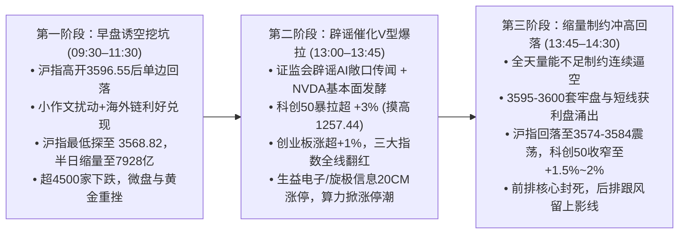

# 2026-11-18 英伟达Q3财报复盘与A股日内V反及后半周（11.19–11.20）波段交易计划

> [!abstract] 核心摘要与关联笔记
> - **数据截点**：美东 2026-11-17 盘后（北京时间 11-18 凌晨）英伟达 FY27 Q3 财报及电话会；A股截至 **2026-11-18（周三）14:30 尾盘前夕** 实时盘面。
> - **前序关联笔记**：[[2026-11-15 周末全球宏观复盘与下周A股波段交易计划]] · [[2026-11-10 美国10月CPI复盘与周三A股及IM2703波段作战计划]] · [[2026-11-06 周度复盘与下周(11.09-11.13)IM2703均线夹板波段计划]] · [[2026-11-01 A股政策底与市场底复盘及下周波段交易计划(IM2703)]]
> - **核心结论**：
>   1. **前序预判印证**：在 [[2026-11-15 周末全球宏观复盘与下周A股波段交易计划]] 中，我们明确指出**“全周核心变盘时间窗在周三（11月18日，对应英伟达财报落地）”**。周一周二（11.16–11.17）A股如期缩量回踩（沪指回撤至3570一带、中证1000回撤至6055–6092一带，工行在9.06–9.09元再创历史新高对冲）；
>   2. **周三（11.18）日内三折戏**：早盘受“公募上报AI敞口”不实传闻扰动，A股对NVDA炸裂财报演绎“高开低走诱空”，沪指最低精准探至 **`3,568.82`**；午间证监会辟谣落地 + 算力基本面共振，午后13:00–13:45 **科创50暴拉超 +3%（摸高 `1,257.44`）** 带领三大指数全线翻红；14:00后受制于早盘缩量（半日7,928亿，同比缩超千亿），后排获利盘涌出引发小幅回落分歧，**确立了“3568点针探铁底有效 + 需二次回踩确认”的磨底反转结构**。

---

## 一、外部催化与宏观基本面复盘（截至 2026-11-18）

### 1.1 英伟达（NVDA）FY27 Q3 财报与治理层定调：史诗级业绩 vs “后黄仁勋时代”重构

| 维度 | 核心数据 / 事件定格 | 市场预期对比 | 波段交易映射与A股传导逻辑 |
| :--- | :--- | :--- | :--- |
| **Q3 营收与盈利** | 单季营收 **`$1,158亿`**（同比 **+103%**，环比 +20%），首次单季破千亿美元；GAAP净利润 **`$653亿`**（同比 +105%），Non-GAAP EPS **`$2.68`** | 华尔街预期营收 `$1,091亿`，EPS `$2.47`（**全面超预期 Beat**） | 彻底证伪“全球AI算力CapEx见顶论”，算力硬件底层需求依然处于狂暴扩张期。 |
| **数据中心与 Rubin 架构** | 数据中心营收 **`$1,076亿`**（同比 +110%，占总营收93%）；新一代 **Vera Rubin（NVL72）平台** 首季量产即贡献近 **`$200亿`** 收入；订单积压达 `$2.5万亿` | 打消了市场对黄仁勋离职后 Rubin 架构延期交付的最大顾虑 | 直接引爆今日A股高多层 **PCB（生益电子20CM涨停）、铜缆高速连接、先进封装（盛合晶微）**。 |
| **Q4 业绩指引与回购** | FY27 Q4 营收指引 **`$1,300亿`**（±3%），上调 FY28 全年营收增速指引至 **75%**；批准新增 **`$1,500亿` 巨额股票回购** | 华尔街预期 Q4 营收 `$1,251亿–$1,252亿` | 财报发布前正股收于 `$155.46`（守住前序笔记锚定的 `$150–$155` 趋势支撑线），盘后大涨 **+4%~+5%**。 |
| **董事会与黄仁勋去留** | 财报前数小时黄仁勋发声称“若符合股东利益愿回归任CEO”；但电话会上新任董事长 **Harvey Jones 明确表态“董事会一致接受辞呈，无意重新任命黄仁勋为CEO”**，由临时CEO Colette Kress 主持过渡 | 创始人光环溢价永久性剥离，叠加对华芯片出口合规审查趋严 | **核心预期差**：海外“达链”情绪修复但估值受美债5.1%与治理折价压制；反过来倒逼**国内政企算力加速向华为昇腾、本土算力租赁及自主可控芯片倾斜**！ |

### 1.2 国际宏观与国内基本面背景
1. **海外分母端紧箍咒仍在**：美国10月CPI（环比+0.4%）与PPI（同比+6.5%）粘性超预期，美联储高层就AI数据中心推升电力与芯片通胀展开听证，**10Y美债收益率稳居 5.1% 上方**，美元指数维持 103.5 高位。强美元与高实际利率导致**黄金/贵金属板块今日在A股领跌重挫**。
2. **国内宏观与监管微调**：
   - 经济基本面延续“K型分化”（外需与高技术制造强，传统内需温和），政策处于“存量落实期”；
   - **今日午间关键催化**：早盘市场疯传*“监管要求公募基金上报全部产品AI敞口”*引发机构恐慌砍仓，**午间证监会正式辟谣该传闻不实**；叠加工信部推动 **6G创新发展试点** 消息落地，直接点燃了午后的踏空回补潮。

---

## 二、A股日内三阶段演化与主要宽基技术结构拆解（2026-11-18）

### 2.1 11月18日（周三）日内分时三阶段复盘

### 2.2 主要宽基指数技术结构与关键点位总表（截至 11.18 午后 14:30）

| 宽基指数 | 11.17 (周二) 收盘 | **11.18 (周三) 日内关键点位** | 均线与量价结构特征 | **关键支撑位 (S1 / S2)** | **关键阻力位 (R1 / R2)** | Swing 结构定性 |
| :--- | :---: | :--- | :--- | :--- | :--- | :--- |
| **上证指数** `000001.SH` | ~3,584.5 | 开盘 **3,596.55** 最低 **`3,568.82`** 午盘 3,570.21 (-0.40%) 14:30 约 **3,574–3,584** | 跌破60日生命线，5/10/20日均线反压；但 **3,565–3,570 区间经受住了日内针探考验**；工行（11.17收9.06元创历史新高后高位横盘）与煤炭护盘 | **S1：`3,565–3,570`** *(日内铁底)* **S2：`3,500–3,520`** *(周线支撑)* | **R1：`3,596–3,615`** *(今日高点+MA60)* **R2：`3,650–3,680`** *(箱体中枢)* | **箱体下沿弱平衡** *(探底有效，待放量收复MA60)* |
| **科创50** `000688.SH` | **1,221.19** *(+0.62%)* | 午盘 **1,227.00 (+0.48%)** 午后最高 **`1,257.44` (>+3%)** 14:30 约 **1,240–1,248** | **全场最强多头旗帜**！在1,200点箱体下沿获强支撑后走出“日线反包”雏形，14:00后虽留部分上影线，但资金介入最深 | **S1：`1,220–1,225`** *(5日线/起涨位)* **S2：`1,180–1,200`** *(箱体铁底)* | **R1：`1,257–1,265`** *(今日高点)* **R2：`1,300–1,320`** *(月初高点区)* | **强势箱体右侧领涨** *(Alpha与高Beta主战场)* |
| **创业板指** `399006.SZ` | ~2,292.1 | 午盘 **2,278.82 (-0.58%)** 午后一度 **涨超 +1% (>2,310)** 14:30 约 **2,285–2,295** | 早盘一度跌超 -1.1%，午后随算力硬件翻红，但受制于宁德等权重与传媒医药拖累，弱于科创50 | **S1：`2,250–2,265`** *(今日低点区)* **S2：`2,180–2,200`** | **R1：`2,320–2,350`** *(MA20/60交汇)* **R2：`2,420`** | **下降通道下轨超跌反抽** |
| **沪深300** `000300.SH` | **3,976.46** *(-0.08%)* | 围绕 **3,960–3,990** 窄幅震荡 | 跌破4,000点后波动率极度收敛，大金融与家电（长虹美菱、九阳股份）提供防御垫 | **S1：`3,930–3,950`** **S2：`3,850`** | **R1：`4,015–4,030`** **R2：`4,100`** | **防御型收敛筑底** |
| **中证1000** `000852.SH` | **6,092.40** *(-1.17%)* *(最低 6,055.73)* | 早盘随微盘股下探 **6,030–6,050** 区域，午后随算力反弹收复 **6,080–6,110** | 周一至周二连续回撤（从周五6,357跌至周二最低6,055.73，精准回踩6,000–6,050强支撑区），今日盘中完成6,050一带二次确认 | **S1：`6,030–6,055`** *(周二/三双底)* **S2：`5,980–6,000`** *(整数大关)* | **R1：`6,180–6,225`** *(周二高点)* **R2：`6,350`** *(上周五收盘位)* | **急跌释放后构筑双底** *(配合2611交割移仓修复贴水)* |

### 2.3 11月18日板块与个股多空矩阵（“弃软从硬、去伪存真”）

- **【核心领涨主线：算力硬件 + 华为算力 + 算力租赁】**（14:00回落中依然封死或高位抗跌的真龙头）：
  - **科创板20CM硬件先锋**：**生益电子**（20CM涨停，受Rubin高多层PCB催化）、**卡莱特**（20CM 2连板）、**旋极信息**（20CM涨停）、**盛合晶微 / 华丰科技 / 华虹宏力 / 润泽科技**（大涨 >10%），带动 **深南电路、沪电股份、四会富仕** 集体走强。
  - **主板10CM算力容量与连板核心**：**华东重机**（算力芯片 4连板，全场空间板之一）、**美利云、利通电子、润建股份、中嘉博创、城地香江、华胜天成、真视通、四川长虹** 掀起涨停潮。
- **【支线轮动：6G通信 + 家电/红利高标 + 煤炭】**：
  - **6G概念**：**武汉凡谷** 等受工信部6G试点催化异动；
  - **家电与煤炭**：人气高标 **九阳股份** 上演“地天板”，**长虹美菱** 走强；煤炭股 **安泰集团** 直线涨停（博弈明年煤价中枢高位）。
- **【风险释放/领跌重灾区】**：
  - **AI传媒应用/短剧漫剧**：**文投控股、浙文影业** 等多股跌停（资金坚决“弃软从硬”）；
  - **贵金属/黄金与CRO医疗**：受10Y美债 >5.1% 与强美元压制，黄金股重挫；尾部微盘低价股继续面临退市预警折价。

---

## 三、后半周（11.19–11.20）推演与 Swing Trader 实战策略

### 3.1 为什么 14:00 后冲高回落？后半周最可能的剧本推演

> [!important] 核心量价定性：“缩量脉冲必有回踩，二次确认才是重仓击球点”
> 1. **回落内因（量能缺口）**：今日早盘两市成交仅 **7,928亿元**（较昨日同期缩量超1,000亿），全天预计在 **1.45万亿–1.52万亿元** 左右，尚未突破 **1.60万亿** 的右侧反转阈值。午后第一小时的暴拉主要靠“辟谣后的空头回补与踏空抢筹”，到了14:00后，3,590–3,600点上方的短线套牢盘逢高兑现，导致指数冲高回落。
> 2. **积极信号**：
>    - 上证 **`3,568.82` 点** 与中证1000 **`6,030–6,055` 点** 的箱体下沿支撑经受住了早盘极致恐慌的考验；
>    - 领涨主线（**科创50 + 国产算力/AI硬件**）在14:00后的回落中前排封单极其稳固，说明主力资金已完成建仓试盘。

#### 后半周（周四 11.19 – 周五 11.20 期指交割日）走势剧本：
- **核心剧本（概率 75%）：周四早盘分歧回踩（Double-Test）$\rightarrow$ 周四午后至周五迎来“分歧转一致”二波上攻**
  - **周四早盘（09:30–10:30）**：今日午后冲高跟风买进的短线浮筹，在明早面临获利兑现压力，预计上证指数将再次回踩 **`3,570–3,575` 点**，科创50回踩5日均线（**`1,225–1,235` 点**），中证1000回踩 **`6,050–6,070` 点**。
  - **确认转折**：只要明早回踩不跌破今日最低点（沪指 `3,568` / 科创50 `1,215`），且今日涨停的算力前排（华东重机、卡莱特、生益电子）不出现核按钮跌停，资金将在10:30后完成“分歧转一致”承接，叠加周五 `2611` 期指交割完成，开启持续2~3周的跨月波段反弹（目标回抽沪指 `3,650+`、科创50 `1,300+`）。
- **次要剧本（概率 25%）：若外围美股今夜对NVDA财报演绎“高开低走收大阴线”**
  - 若今夜美股NVDA未能守住盘后涨幅反而破位 `$150`，导致明日A股放量跌破 **`3,565` 点**，则指数将向下考验 **`3,500–3,520` 点** 终极支撑（触发极端挖坑剧本）。

---

### 3.2 具体投资建议与仓位执行指令（Actionable Playbook）

#### 1. 仓位控制（Position Sizing）
- **今日尾盘（11月18日 14:40–15:00）**：
  - 鉴于14:00后有所冲高回落，**尾盘不追高单一个股，总仓位维持在 `50%` 左右**；
  - 若仓位偏轻（<30%），尾盘仅用 **10% 仓位** 试探性买入 **`科创50 ETF (588000)`** 或 **`科创芯片 ETF (588200)`** 拿先手底仓，保留至少 **30%–40% 现金子弹** 给周四早盘的分歧回踩！
- **周四（11月19日）早盘加仓触发点**：
  - 当早盘 09:45–10:30 科创50缩量回踩 **`1,225–1,235`**（或沪指回踩 `3,570` 不破）且分时企稳拐头时，将总仓位推升至 **`65% – 70%`**。

#### 2. 宽基与板块配置结构（哑铃型向“科创硬科技”倾斜）
1. **【进攻核心（占持仓 60%）】：科创50 + 算力硬件/国产算力**
   - **宽基工具**：首选 **`科创50 ETF (588000)`**（Beta弹性与资金共识远强于创业板指和中证2000）。
   - **个股核心方向（逢分歧回踩5日线/分时VWAP低吸，绝不追高后排）**：
     - **AI服务器PCB與铜缆高速连接**：以 **生益电子、沪电股份、深南电路** 为风向标（直接受益于 NVDA Vera Rubin NVL72 量产放量）；
     - **国产算力芯片与华为昇腾/算力租赁**：以 **华东重机（4板空间标）、卡莱特（20CM 2板）、润建股份、四川长虹、盛合晶微/华虹宏力** 为观察锚，博弈周四早盘“首阴分歧或换手回封”的二波买点。
2. **【防守底仓（占持仓 40%）】：沪深300 ETF (`510300`) / 银行与家电红利**
   - 工商银行（`9.06元`）等大行在连续创历史新高后进入高位窄幅横盘。继续作为底仓对冲波动，但**严禁在银行红盘时加仓**；一旦后半周两市放量突破 1.60 万亿且银行出现放量绿盘流出（参考前序笔记 `r = -0.80` 跷跷板模型），果断将银行防守仓位切换至科创50与算力主线！
3. **【坚决规避/清退清单】**：
   - **AI传媒/短剧漫剧/影视游戏**（文投控股等跌停潮，资金流出明显）；
   - **黄金/贵金属**（受美债>5.1%与强美元压制，中期调整未完）；
   - **缺乏业绩支撑的尾部微盘股/低价股**（年底退市风险与流动性折价）。

#### 3. 期指（`IM2703` / `IM2612`）后半周交割移仓操作要点
- **位置评估**：中证1000现货在周二（最低 `6,055.73`，收 `6,092.40`）和周三早盘（`6,030–6,050`）已完成了对前序笔记设定的 **`Tier 1 / Tier 2` 低吸支撑区** 的回踩测试，较上周五（`6,357`）累计释放了近 300 点风险。
- **周四/周五执行策略**：
  - 紧盯明日早盘中证1000在 **`6,040–6,070`** 区间的二次回踩承接；
  - 本周五（11月20日）为 `IM2611` 交割日，今明两天是最后移仓窗口。重点观察 `IM2612` 与 `IM2703` 在盘中回落时**基差（贴水）是否被动收敛**——若现货回调但期指抗跌（贴水收窄），则是机构多头借交割周移仓逢低锁仓的明确信号，可继续持有 `IM2703` 底仓多单，波段第一止盈目标看中证1000回抽 **`6,200–6,250`** 区间（遵循“先平昨、后买开”铁律）。

---

## 四、明日（11月19日 周四）盘前与盘中观察哨（Checklist）

- [ ] **07:00 盘前复盘**：确认今夜美股 **NVDA 正股收盘表现**——能否站稳 **`$160–$165`**（守住盘后 +4%~5% 涨幅）及费城半导体指数（SOX）是否收涨。
- [ ] **09:25 集合竞价检验**：盯紧今日三大算力风向标——**华东重机（4板）、卡莱特（20CM 2板）、生益电子（20CM趋势容量龙）** 的竞价开口：
  - *超预期（强一致）*：三者高开 >3%~5% 且封单/承接有力 $\rightarrow$ 算力主线延续，逢分时回踩均价线果断低吸核心容量票与 `科创50 ETF`；
  - *不及预期（大分歧）*：前排大面积低开或冲高爆量被砸 $\rightarrow$ 放弃早盘开仓，耐心等待指数回踩 `3,568–3,570` 支撑位后的尾盘信号。
- [ ] **10:30 量能与跷跷板验证**：观察两市首小时成交额是否较今日（半日7,928亿）温和放量，以及 **工商银行（`601398`）** 在 `9.05–9.09元` 历史高位是否出现筹码松动流出、反哺科创板与双创。
